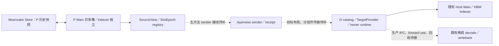

# P KV buffer reuse 与 PD transfer：代码 review 摘要

2026-11-04。本文面向第一次审查这组改动的开发者，汇总我方和 connector 同事的工作。
**P 复用／Store、源接口、目标 provider 和 owner runtime 已有实现与分层验证；
新的 P Main 共享槽 → D Host Main／HBM Indexer → 稀疏 decode 全链路仍待接通。**
建议分别审查模块正确性和集成缺口，不将“接口已实现”视为“端到端已通过”。

## 1. Review 范围与双方提交

- 当前仓库分支：`p-main-buffer-reuse`，部署工作区 `deploy-glm52/src/vllm-ascend-reuse`。
- 功能基线：`4234a1f1815252e8b52c75d6956d0bdf9ae80cc0`（`dsa_offload_rebase_30`）。
- 本文审查代码快照：`e817452b2e2b648c2bc07485c9c0138bc935565e`。
- 相对基线：50 个文件，约 9635 行新增／85 行删除，包含实现、测试和交接文档。
- 当前分支已纳入双方代码并保留原提交历史；不需要再整批 cherry-pick 原 P 分支。
  旧 `m1-prefill-reuse` 实验分支不属于本轮 review 范围。

“我方”对应 Git 作者 Evariste Gao；“connector 同事”对应 YYangY。共享契约由两侧对齐使用。

| 提供方／阶段 | 提交 | 本阶段交付 |
| --- | --- | --- |
| 上游／设计基线 | `4234a1f18` 及其祖先 | 既有 Mooncake Host pool、稀疏 offload manager／算子、blockwise DSA 注册和传输参考；不是本次重新开发 |
| 我方：P 复用核心 | `9824ec91c`、`f9b995c68` | Main 共享 HBM 槽，Indexer 独立，预算规划、Store 恢复／保存、计算完成屏障、partial 快照及失败保护 |
| 我方：源接口 | `47f983157`、`bd683f701` | 源视图／槽 epoch、五方法 consumer、Store 接线、显式 restore-only driver 及交接 |
| 我方：目标核心 | `06e16d717` | `RegisteredTargetProvider` 四方法、已有 DSA 布局适配工厂、17 项 UT |
| connector 同事 | `a5581b90a`、`e26962a4b`、`bc51f47e8` | 双账本、逐层回执／terminal、规格随 metadata 跨进程下发、provider 注入、release 入口及 retention token 签发 |
| connector 同事：集成／文档 | `5af09db2e`、`6c233175d` 等 | 合入我方源接口和目标核心，对齐契约及交接；不是再次实现同一套 P 代码 |
| 我方：A1/A2 | `e817452b2` | 真实资源持有／可见性／同步 release，注册 catalog、稳定 owner facade、纯数据 IPC 适配、初始化入口及原生测试 |

建议按三个 diff 阅读，避免一次审查全部历史：

```bash
# 我方 P 核心、源接口及 TargetProvider
git diff 4234a1f18 06e16d717 -- vllm_ascend tests
# 同事 receipt 增量（该树已经包含上述 P 代码）
git diff 06e16d717 6c233175d
# 最新 A1/A2、测试与交接
git diff 6c233175d e817452b2
```

## 2. 设计目标与当前模块边界

目标是在 P 侧把多个逻辑层的 Main KV 映射到少量物理 HBM 槽，以相同显存支持更多 blocks。
Indexer 保持独立分配；历史 Main KV 保存到 Mooncake Store，后续 chunk／prefix 命中时逐层恢复。
D 的目标方案复用既有 Host Main、HBM Indexer 和稀疏访问／写回能力，逻辑层在 D 上仍独立存储。
**P 的 Store 历史对象与 D 的 Host 请求运行内存有不同生命周期。**



图中虚线是未闭合的调用链。现有 sender 仍从旧 hooks 发任务；新 registry 不会自动接管它。

| 关注点 | 代码入口 | 已有能力与边界 |
| --- | --- | --- |
| 物理布局／预算 | [layerwise_cache_layout.py](vllm_ascend/distributed/kv_transfer/kv_pool/ascend_store/layerwise_cache_layout.py)、[worker.py](vllm_ascend/worker/worker.py) | Main 共享与独立层使用同一 planner；Indexer 的容量与独立存储必须一起计入预算 |
| 逐层计算／Store 依赖 | [pool_worker.py](vllm_ascend/distributed/kv_transfer/kv_pool/ascend_store/pool_worker.py)、[kv_transfer.py](vllm_ascend/distributed/kv_transfer/kv_pool/ascend_store/kv_transfer.py)、[attention_fence.py](vllm_ascend/distributed/kv_transfer/kv_pool/ascend_store/attention_fence.py) | 空 GET 也经过覆盖保护；计算完成与保存完成分开管理，不能把 KV scatter 当成 attention 完成 |
| 快照／请求状态 | [session_tracker.py](vllm_ascend/distributed/kv_transfer/kv_pool/ascend_store/backend/session_tracker.py)、[metadata.py](vllm_ascend/distributed/kv_transfer/kv_pool/ascend_store/metadata.py)、[pool_scheduler.py](vllm_ascend/distributed/kv_transfer/kv_pool/ascend_store/pool_scheduler.py) | partial／private 快照与跨 step 恢复；Store 私有对象 key 不作为 PD wire 契约 |
| P 源接口 | [reuse_source.py](vllm_ascend/distributed/kv_transfer/kv_pool/ascend_store/reuse_source.py)、[ascend_multi_connector.py](vllm_ascend/distributed/kv_transfer/ascend_multi_connector.py) | `open_source / source_ready / seal_source / wait_source / abort_source`；真实 sender 尚未声明并接入 version-1 consumer |
| 双方契约 | [mooncake_layerwise_contract.py](vllm_ascend/distributed/kv_transfer/kv_p2p/mooncake_layerwise_contract.py) | RequestKey、TransferKey、TargetLease、CacheView、WriterPlan、ReceiveReceipt 和 ReleaseAck 等纯数据及能力校验 |
| 同事的 receipt 实现 | [mooncake_layerwise_receipt.py](vllm_ascend/distributed/kv_transfer/kv_p2p/mooncake_layerwise_receipt.py)、[mooncake_layerwise_connector.py](vllm_ascend/distributed/kv_transfer/kv_p2p/mooncake_layerwise_connector.py) | P SlotLedger／D ReceiptLedger、LAYER_RESULT／RANK_TERMINAL、worker 规格安装及 release 入口；仍有下述已知缺口 |
| 目标租约核心 | [target_provider.py](vllm_ascend/distributed/kv_transfer/sparse_kv_offload/target_provider.py) | 全 prompt 容量／身份校验、活动 blocks 排他、四方法状态机；必须传入真实 runtime |
| A1：owner 生命周期 | [target_runtime.py](vllm_ascend/distributed/kv_transfer/sparse_kv_offload/target_runtime.py)、[target_retention.py](vllm_ascend/distributed/kv_transfer/sparse_kv_offload/target_retention.py)、[allocation_lifetime.py](vllm_ascend/distributed/kv_transfer/utils/allocation_lifetime.py) | 原池／注册 pin、权威 guard、真实接收依赖、use 完成事件、同步释放和失败 quarantine；不等于已接入 scheduler 的所有 free 路径 |
| A2：注册目录／进程边界 | [target_catalog.py](vllm_ascend/distributed/kv_transfer/sparse_kv_offload/target_catalog.py)、[target_owner.py](vllm_ascend/distributed/kv_transfer/sparse_kv_offload/target_owner.py) | 导出已有分配，持有原 storage；延迟绑定 facade、dispatcher/client；实际生产 transport 仍由 connector 接入 |
| 资源／初始化适配 | [mooncake_host_pool.py](vllm_ascend/distributed/kv_transfer/sparse_kv_offload/mooncake_host_pool.py)、[sparse_kv_offload_manager.py](vllm_ascend/distributed/kv_transfer/sparse_kv_offload/sparse_kv_offload_manager.py)、[mooncake_transfer_engine.py](vllm_ascend/distributed/kv_transfer/utils/mooncake_transfer_engine.py) | 原 Host allocation、TP backing 身份、成功注册快照、close/unregister 保护和注册后绑定；不分配第二套生产 KV |

工程辅助改动还包括 CPU 测试依赖垫片、`te` 缩写的拼写白名单，以及仅允许四个
序列化／拒绝活对象测试导入 pickle 的检查例外；生产代码导入限制没有放宽。
测试替身和模拟完成事件不能作为真实数据面完成证明。

## 3. Reviewer 应检查的关键不变量

1. **P 写槽安全**：覆盖旧层前，旧 attention 读取、Store 对源 buffer 的读取、所有 PD 读者均结束；入队／RPC 成功不算完成。
2. **完成状态分离**：KV-ready、attention-done、source-read-done、snapshot-committed、D request ready 不混用。
   同 step 的槽位释放不能等整对象 commit，否则 B=1 可能死锁；跨 step GET 则必须读已提交快照。
3. **源代次封口**：`source_ready` 先登记完整 batch 读者再发布任务；即使空 batch 也须 seal；失败不能被后续 event.set 或下一代覆盖吞掉。
4. **真实目标与身份**：Main 来自原 Host pool，Indexer 来自原 device storage；层、组件、entry、group、物理 page/stride、容量与 block IDs 一致。
   TP 共享 Host backing 的身份不能靠跨进程虚拟地址相等判断；注册拆分也不能伪造多个 backing。
5. **可见性与计算范围**：先有完整 receipt 及真正的远端 Host-visible fence／Indexer device event，再执行 `prepare_decode`。
   依赖安装到实际消费 stream；真实 forward／异步 writeback 必须被 owner 的 `use()` 和 stream 完成证明覆盖。
6. **两种释放许可**：owner 本地 release 只证明本地计算／写回静止。B 仍须证明所有远端 DMA／rank 静止，取得安全 ReleaseAck 后 retire，最后调用 scheduler free。
   guard 不调用 `BlockPool.touch()`，避免提高 ref_cnt 引发 decode COW；它本身也不拦截绕过它的 free。
7. **并发与进程边界**：等待和外部 callback 不持状态锁；部分失败回滚保持 quarantine；tensor／锁／事件／基址留在 owner，IPC 只传纯数据。
   源 epoch、Store 快照、transfer、allocation 和 registration 的代次分别管理，禁止旧回调释放新占用。

建议特别看 `ReuseSourceRegistry.begin_write/publish`、`RegisteredTargetProvider` 状态迁移、
`OwnerTargetRuntime.retain/make_visible/use/release`、`SchedulerRetentionRegistry.issue/retain/retire`，
以及 `configure_target_owner → register_kv_caches → bind_registered_target_owner` 的次序。

## 4. 尚未闭合的接线与已知 review 风险

以下是当前集成快照的验收欠账，不是对同事工作完成度的推测；A1/A2 没有顺带修复全部 connector 逻辑。
其中协议缺陷在 `6c233175d` 阶段已有 CPU 控制流复现，最新提交没有改动相应核心方法；
reviewer 仍应核对新 facade 门禁下的实际可达路径，不能把 CPU 复现等同于所有故障均已在 NPU 端到端触发。

| 优先级 | 问题／剩余工作 | 建议审查入口／验收要求 |
| --- | --- | --- |
| 最高 | 新源 consumer 未接真实 sender；旧 hook 不能重复发 | sender 与 SourceView／SlotEpoch 使用同一代次、同一读者状态；restore-only 无 forward 也能发送 |
| 最高 | D admission／worker-ready 与通知 P 的顺序 | `update_state_after_alloc` 当前先提交 metaserver 异步任务，再 `_maybe_publish_target`；要求真实目标持有且 worker 就绪后才通知 |
| 最高 | 未完整消费目标 catalog／lease／writer plan | 绑定 Host Main 和每 rank Indexer，按内存类型组批、明确 Main writer 与有效 tail 字节范围；不能继续只用旧 remote metadata |
| 最高 | receipt 覆盖计划和失败判定不足 | `ReceiptLedger._data_ready` 不能只按 backing／rank 汇总并集；必需层／组件／entry 要显式覆盖，FAILED 条目不能被 success terminal 掩盖 |
| 最高 | 错误放行与普通模式兼容 | `_maybe_publish` 缺 provider／lease 的分支不能跳过 prepare；关闭模式不能仍带 instance 导致 P 进入 receipt 而 D 无账本 |
| 最高 | 真正的 block retention／远端静止未闭合 | `bc51f47` 的字符串 token／scheduler 字典需接到权威 registry 和生产 RPC；正常、取消、抢占均须经安全回收门禁 |
| 高 | wire 身份和代次未完整落地 | sender 使用空 backing、部分 generation 固定 0；不能混淆 transfer 与目标 allocation generation 或通过假身份绕过契约 |
| 高 | 组件回执与 terminal 错误路径 | `_emit_layer_results` 按 primary tensor 数量推组件；Main 与 Indexer data/scale 同 group 时可能漏 Indexer，历史失败清除后可能误发 success terminal |
| 高 | 请求清理／未知回执／丢回执 | internal/external ID 与 request_instance 生命周期一致；审查 `forget_request`、未知 instance 的丢弃并 ACK、有界错误通道及迟到回调 |
| 高 | 生产 owner 挂载仍需调用方供真实依赖 | facade／factory 已实现；完整 Host 注册、retention transport、receive fence、forward use 范围和 scheduler free hooks 仍须 B/J 接入 |
| 中 | connector 测试未实际覆盖接线 | `test_layerwise_connector.py` 的类名以 Tests 结尾，现有默认收集检查为 0 项；不能用 27 项纯账本 UT 替代这些测试体 |
| 中 | 性能与容量需要独立测量 | 分别统计共享 Main、独立 Indexer、Host pool、selection/staging、注册区域及等待时间；当前没有新链路的无复用同配置性能对照 |

首版支持边界为 V1 eager、PP/CP/DCP=1、无 MTP/speculative、已核实布局；目标 PD 链路要求同 TP、同 Main 布局及 BF16 Main。
已有 P-only INT8 1M 档不能直接拼接到 D BF16 Host Main；v1 一 backing 一 region，分段 MR 需限制配置或共同扩展契约。
D 跨层共享、异构 TP、量化转换和图模式不属于当前已验证能力。

## 5. 验证证据与结论边界

| 验证 | 已有结果 | 不覆盖的内容 |
| --- | --- | --- |
| P 独立 1M（较早 r05，`9824ec91c/f9b995c68` 阶段） | 1048541-token 冷 prefill＋首 token 检索通过；约 3375.79 秒；同 archive 中／后部命中恢复检索通过 | 不是最新 receipt 模型链路的 1M 验收，也不是三次独立冷请求 |
| P 源接口／restore-only | 受控读者、真实 NPU／Store 的约 64K 测试，B=1/2/3 合成 KV 恢复与阻塞保护已有证据 | 不是已接上真实 PD 网络 sender 或自动 scheduler admission |
| 旧 connector 模型回归（`06e16d717`） | 几 K～32K 的旧 layerwise PD、并发／prefix／连续输出通过 | D 为普通 HBM INT8，无 Host offload、无 receipt；该轮 P 独立 64K 检索有失败，不能称整轮全绿 |
| P 聚焦 CPU 回归 | 139 项通过，归回原目录后复跑通过 | 不是全仓 UT 或所有 NPU 路径 |
| receipt 纯账本 | 27 项通过 | 不证明真实 connector 接线、数据面或生命周期完整 |
| target lifetime/runtime/provider | 40 项通过，包括失败保留、原 storage、代次、真正父子进程 Pipe | 使用 CPU storage／测试 driver；不单独证明 NPU 或生产 RPC；与 139 项存在 17 项 provider 重叠，勿相加冒充独立总数 |
| 注册／HostPool | 16 项及 4 子用例通过 | 部分旧断言已按 legacy HostRegister／fallback 语义修正，原基线失败记录保留 |
| A1/A2 原生目标资源 | TP1／TP2 通过；真实 HostRegister、HIXL RoCE 注册、BF16 Host Main／device Indexer、stream/event、延迟 writeback 释放保护、共享 backing 身份和实际 scheduler 分配验证 | 小规模合成 KV；Host fence 对应本地真实写完成，不代表远端 PD Host-visible、完整稀疏模型 decode 或取消回收 |
| 代码与静态检查 | 迁回后的 733 项生产源码／原生测试脚本摘要一致；本次变更 manual hooks 通过 | `bash format.sh ci` 全仓检查有继承的 Ruff／拼写等失败，详见验证报告，未标为通过 |

另外保留两个未解决的边界：

- 曾出现 64K 错误答案／NaN；纯计算对照也曾失败，根因未确定，用户已要求暂停定位。不能由重放通过推断已修复，也不预判属于 reuse 或 receipt。
- A1/A2 后的恢复审计曾给未安装新代码的旧 P r05 发 `max_tokens=16`，触发 `Main reuse could not open the complete committed Store prefix` 并使引擎退出。
  原容器恢复后 `max_tokens=1` P-only 检查通过；这不构成旧 P 多 token decode 已通过的证据。

原生测试和恢复结束后原 P r05／D r03 的 ID、镜像、脚本、源码摘要与健康／空闲审计均通过；测试容器 r14 停止。
原始日志在独立部署仓 `deploy-glm52/artifacts/p-main-buffer-reuse/` 的 `target-owner-runtime/`、
`two-branch-inventory/`、`target-regression/`、`pd-source-runtime/` 与 `branch-consolidation/` 等目录，不随本源码仓推送。

## 6. 建议的 review 交付与后续验收

优先反馈：共享槽覆盖条件是否充分、各类完成／代次是否独立、owner 资源生命周期是否真实，
以及第 4 节中会误放行、提前回收或破坏普通模式的路径。需要分清模块缺陷、接线缺失、已有支持限制和待验证项。

后续完整验收还需：B 的 sender／目标数据面／receipt 修正，生产 owner 与 scheduler IPC/free 接线，
然后用同布局 BF16 Main 的短模型请求覆盖内容、连续 decode/writeback、prefix、并发、取消／抢占和失败重分配；
通过后再做长上下文及同配置性能测试。当前摘要不作生产可用或 1M PD 端到端可用声明。

详细入口：

- [P 源接口与历史交接](PD_TRANSFER_HANDOFF.md)
- [同事 receipt 交接（保留原阶段记录）](RECEIPT_HANDOFF.md)
- [最新 owner 接口与 B/J 调用要求](TARGET_OWNER_RUNTIME_HANDOFF.md)
- [最新验证与失败记录](TARGET_OWNER_RUNTIME_VALIDATION.md)
- [实现状态／缺口清单](PD_TRANSFER_IMPLEMENTATION_STATUS.md)、[后续计划](PD_TRANSFER_IMPLEMENTATION_PLAN.md)

无需设备即可先运行纯账本检查：

```bash
python3 tests/ut/kv_offload/test_layerwise_receipt.py -v
```

CPU 其余测试需相应 torch／测试依赖及构建信息垫片；部署仓已有 `tools/run_prefill_reuse_ut.py`
及 `artifacts/p-main-buffer-reuse/target-owner-runtime/run_ut.py` 辅助入口，后者的默认位置已指向原工作区。
手动原生检查位于 `tests/e2e/kv_transfer/target_owner_runtime_npu.py`，只在空闲设备和正确环境中运行；
该脚本验证合成目标资源，不负责停服务，也不替代上述完整模型验收。
