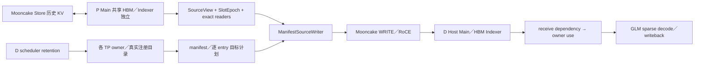

# Prefill KV buffer reuse 与 Mooncake PD transfer 项目交接

## 2026-11-06 性能验证更新

- 已验证的优化覆盖 TP16 owner 并行获取、登记、就绪查询和回收，缩减逐 rank 的登记载荷和租约复制，
  并在 P 的同一发送请求内复用解析后的目标描述。保留全 rank 回执及失败保留门禁。
- D scheduler 按实际 block manager 为每个已调度 step 校验一次保留分配。D worker 核对当前 step 的分配
  和已安装 lease，继续持有本地 guard 及 stream fence。实机九条 62K 请求正确并回收。
- TP16、32,784 chunk、513 blocks 的匹配样本中，同步完整 P/D 冷 TTFT 中位数 24.00 s，
  一体纯 HBM 为 20.03 s。回放 TTFT 分别为 5.36 s（Mooncake Store 命中）和 0.55 s（本地 HBM 命中）。
- 独立 D 异步调度候选的冷 TTFT 为 23.98 s。62K 的 29-token 样本在首 token 后的中位时长由同步的
  12.87 s 降到 8.91 s，一体纯 HBM 为 5.46 s。
- `AsyncReceiptScheduler` 已接入 receipt 源码和 Ansible profile。D 直接用进程内协调器的清单生成 HTTP
  数据，等所有 owner 登记成功后才通知 P。与上一轮异步候选对照，62K 冷目标准备从 1.36 s 降到
  0.75 s，冷／回放 TTFT 中位数为 23.31／4.67 s。实机九条请求正确并完成全 rank 回收。

详细配置、样本及计时口径见部署工作区 `docs/m1-buffer-reuse-runbook.md` §11.57–11.60。

## 2026-11-05 四节点实机验证更新

- Ansible 复现了 `4204f545d` 的 TP1 原生探针。随后在 P r05／D r03 镜像上加载本次修复，完成
  B1/B2/B3 的真实 GLM-5.2 P/D 验证，覆盖三 chunk、Store 回放、双 D 并发和连续生成。
- D 在原有 proof batch ACK 中反馈目标关闭。P 停止后续读取，D 等待全部 writer 静止后才回收。
  实机覆盖首 token 后断连、查询地址前取消，以及首笔 RoCE WRITE 返回后取消。
- writer 关闭时等待已接收作业及源回调入队，再停止 proof 线程。实机覆盖最后一批 WRITE 返回后仍有源回调的情形。
  私有快照删除对已不存在的对象按完成处理，租约冲突保留重试。
- 固定 513 blocks 的纯 HBM 对照走一体 vLLM，B2/Host 和对照各九条请求全部正确。实验后原四引擎和代理
  均恢复 HTTP 200，原 Mooncake Master 启动时间一致。
- 完整模型的自动 restore-only 仍缺 scheduler 选择和跳过 forward 的生命周期。同步 DMA 卡死的安全退出、
  进程级传输资源销毁和旧逐层普通 D HBM 首传兼容性仍待验收。

部署配置和详细证据在部署工作区 `/home/gao/code/Ops/deploy-glm52` 的
`docs/m1-buffer-reuse-runbook.md` §11.52–11.56。

## 原始交接快照

以下记录对应 `4204f545d59f448373794f100ceb6bdd31c7866a` 及随后的原生探针交接，
保留当时的部署限制、实现缺口和现场状态。

**当前原功能目标已由用户暂停。本轮仅整理交接，不代表恢复开发、部署或模型测试。**

P 侧 Main 共享 buffer／Mooncake Store 核心已有真实长请求验证；新 receipt PD
主链已有生产接线、控制测试和 TP1 小规模真实 WRITE／读取验证，仍有六项明确功能缺口。
**完整 GLM 的新 PD 功能与性能尚未验收，不能把当前分支视为可直接上线。**

## 1. 项目、原始目标与用户约束

项目是在 A3 集群上部署 GLM-5.2（`glm_moe_dsa`），基于 vLLM-Ascend v0.30.0rc1，
使用 P/D 分离与 Mooncake KV 池。集群四节点，每节点 16 个 NPU。

核心目标来自 `mc.pdf` 的 reuse buffer 设计：把 P 侧多个逻辑层的 Main KV 映射到
少量共享 HBM 槽，历史 KV 经 Mooncake Store 逐层保存／恢复，用显存换取更大上下文容量。
Indexer 保持独立分配。随后对接同事实现的 receipt connector，把 P 共享 Main 和
Indexer 正确发送到 D 的既有 Host Main／HBM Indexer，支持稀疏 decode 和异步写回。

最新完整任务是：

1. 核对同事的 `feat/layerwise-receipt` 是否补齐 PD 剩余工作，缺失部分继续实现。
2. 完成 Mooncake 池化下各部署档的性能比较，等环境空闲再验证新完整 PD 特性。
3. 对完整特性做功能、正确性、兼容性和性能验证；分析关键路径，有依据地优化。

用户已经明确的约束：

- 所有源码改动留在原 `p-main-buffer-reuse` 分支；用户要自行 push，不切新分支。
- 所有脚本、日志、证据都留在当前工作区，包括过去从 `/tmp` 迁回的文件。
- 仔细审视非只读命令。仅与本开发有关的容器／容器内写操作已获授权；其它集群主机写操作需另行确认。
- 本轮不做耗时的 1M 回归。常用对照是 32K／64K／128K，最新池化矩阵为 32K／64K。
- 旧 64K 异常定位曾被用户叫停；B2/P1 的新池化加载阻塞也尚未定位，不据 B4 通过声称修复。
- 性能优化先分析时间花在哪里、哪些依赖没有掩盖，再选择参数或实现改动。
- DCP 与当前 reuse 特性不同时开启，是已接受的约束。
- 正式完整模型端到端验收前，先补齐本文件第 7 节的实现缺口；开发期间可并行做单元、控制和底层原生探针。

## 2. 仓库、分支与当前未提交内容

| 对象 | 位置／分支 | 说明 |
| --- | --- | --- |
| 部署仓 | 工作区根目录，`glm52-kvoffloading` | Ansible、文档、实验工具 |
| 当前开发源码 | `src/vllm-ascend-reuse`，`p-main-buffer-reuse` | 双方代码已合在这里，是接手开发入口 |
| 源码基线 | `4234a1f1815252e8b52c75d6956d0bdf9ae80cc0` | `dsa_offload_rebase_30`／dsa-base |
| 最新已提交源码 | `4204f545d59f448373794f100ceb6bdd31c7866a` | D 消费、回收接线和元数据容量修复 |
| 同事远端 | `maz/feat/layerwise-receipt` | 最近核对 HEAD 为 `fa5aec40b0cbb4662ec4c5dae68114a850642337`，已合入；这是最近已核对值，不保证交接后远端不再更新 |
| 历史工作区 | `src/vllm-ascend` 等 | root AGENTS 中仍有旧路径／旧分支说明，不应据此把当前开发切回去 |

交接时 `HEAD` 相对 dsa-base 有 32 个提交，累计 88 个文件、约 +19010/−141 行，
包含双方实现、测试和文档。该数字不包含未提交文件。

本次整理提交包含以下源码仓文件（准备交接时它们位于暂存区／工作区）：

- `PD_TRANSFER_COMPLETION_REVIEW.md`：最新原生测试和代码缺口记录。
- `PD_TRANSFER_IMPLEMENTATION_STATUS.md`：顶部更新为最新状态。
- `tests/e2e/kv_transfer/receipt_transfer_npu.py`：新增原生 WRITE／读取／生命周期探针。

本次同时提交本交接文档和上述文件，生产实现基准仍为 `4204f545d`；整理提交见 `git log`。
**未执行 push**。源码仓提交不包含下述部署仓和本地证据，不能只传源码 HEAD 就认为交接齐了。
部署仓也有较多已修改／未跟踪的配置、文档与工具，使用 `git status` 查看；不要整体 reset、clean 或随意暂存。

`src/`、`artifacts/` 的相关内容不随部署仓自动提交。仅 push 源码仓也不会携带部署配置和实验日志，
交接时要同时保留部署工作区和第 11 节的证据目录。

### 2.1 src 下各工作区的关系

| 工作区 | 实际状态 | 交接用途 |
| --- | --- | --- |
| `src/vllm-ascend` | `m1-prefill-reuse`，`3f2a70fd1` | 历史实验主工作区，同时持有共享 Git 数据库 |
| `src/vllm-ascend-reuse` | `p-main-buffer-reuse`，`4204f545d` | 当前唯一开发与 review 入口 |
| `src/vllm-ascend-pd-integration` | `reuse-pd-integration`，`6c233175d` | 合并前历史工作区，未继续在此开发 |
| `src/vllm-ascend-receipt-review` | detached `6c233175d` | 旧分支审查快照，不代表当前远端 HEAD |
| `src/legacy-*` | 遗留迁移目录 | 非当前交付入口，不作批量清理 |

这些相关工作区共用 `src/vllm-ascend/.git`。不要只复制 reuse worktree 的 `.git` 指针文件
就认为搬走了全部 Git 历史。跨机器交接优先从包含已提交分支的 Git remote／bundle 建立独立 clone，
并单独保留未提交补丁和未跟踪文件；当前暂停期间没有执行这些打包／push 动作。
若整体保留工作区，移动路径后还需核对 worktree 元数据，避免旧绝对路径造成误操作。

## 3. 双方已有工作与最近提交

既有基线已经提供 Host pool、稀疏 offload manager／算子、DSA 传输参考；没有重新实现这些底层能力。
我方实现 P 复用、Store 依赖、源接口及目标 owner；同事实现 receipt 契约、账本、回执与 connector 骨架；
最近继续合入同事增量并补生产调用链。完整历史保留在同一分支，不需要重新整批 cherry-pick P 代码。

| 阶段 | 提交 | 主要内容 |
| --- | --- | --- |
| P 核心 | `9824ec91c`、`f9b995c68` | Main 共享 HBM、独立 Indexer、预算、Store 保存／恢复、计算屏障与 partial 快照 |
| 源接口 | `47f983157`、`bd683f701` | SourceView／SlotEpoch、五方法 consumer、显式 restore driver |
| 目标核心 | `06e16d717` | RegisteredTargetProvider、已有布局适配 |
| 同事 receipt 基线 | `6c233175d` 及相关提交 | 合入我方代码，增加契约／双账本／逐层回执／terminal／接线骨架 |
| A1/A2 | `e817452b2` | 真实资源 pin、runtime、catalog、facade 和进程边界适配 |
| 最新远端合入 | `9cbdde548` | 纳入同事至 `fa5aec40b` 的增量并修复集成边界 |
| 第二阶段 | `36e6aa4d3` | owner RPC、反向 retention RPC、scheduler 生命周期保护与生产初始化 |
| 第三阶段 | `aca80d8ef` | manifest 逐 entry 计划、实际 MR 地址解析、全 TP receive admission |
| 第四阶段 | `4c455c943` | SourceReady 直接 writer、exact epoch、原生完成与 peer ACK 分离 |
| 第五阶段 | `4204f545d` | D 接收依赖、整个 model invocation 的 use、全 rank readiness／ReleaseAck、晚到 proof、wire 容量 |
| 第六阶段 | 本次整理提交（见 git log） | 原生小探针及最新说明，不包含新的生产 shutdown 修复 |

旧的 `CODE_REVIEW_SUMMARY.md`、`RECEIPT_HANDOFF.md` 等含历史缺口，部分已经补上。
当前状态先读本文件和 [最新补齐审查](PD_TRANSFER_COMPLETION_REVIEW.md)，再按固定提交阅读历史文档。

## 4. 架构与实际时序

Mooncake Store 的历史快照和 D 的请求运行内存有不同生命周期，不可混用完成标记。



上图表示当前生产接线方向，不表示整幅图已经用真实 GLM 联合验收。

### 4.1 P 共享槽

- `num_shared_buffers` 控制共享 Main 槽，另可配置首尾等独立层；B2/P1 表示 2 个共享 Main 槽、预取 1 层。
  既有配置首尾各独立一槽，因此总 Main 槽为 4；B4/P3 总槽为 6。
- 下一逻辑层覆盖共享槽前，要等待旧计算读取、Store PUT 读取和 PD 原生读取都结束。
  GET 为空也不能绕过覆盖前的保护。
- Store registry 通过 `open_source / source_ready / seal_source / wait_source / abort_source`
  把实际 source view 和代次交给 consumer。完整 batch 的读者先登记，再发布任何任务。
- `SourceReady` 直接准备 manifest 写任务，使用已有 NPU send thread；manifest 请求从旧 save hook
  发送循环中剔除，避免两套路径重复发送。普通请求仍保留旧发送路径。
- 当前 source consumer 等待 exact epoch 的 ready、sealed、全部读者完成且无错误，
  按 slot 保留已完成代次高水位，避免等待旧 Indexer occupant 时追逐新 Main。

### 4.2 D 目标与接收

- D scheduler 的真实 block allocation 经 retention guard 保护；guard 不提高 ref_cnt 来伪造持有，避免触发 COW。
- 每 rank 的 owner catalog 描述已有分配和真实 MR；Main 来自原 Host pool，Indexer 来自原 HBM storage，
  不额外分配第二套生产 KV。Host backing 身份不靠跨进程虚拟地址相等判断。
- `TargetManifest` 保留各 rank 原始 lease；对外 aggregate 只选一个共享 Host Main 注册和所有 rank Indexer。
  **Main 由 P0 唯一写入，Indexer Pi→Di。** aggregate lease 不能冒充某个本地 owner 的原始 lease。
- 实际页大小、stride、group、block ID、entry 和有效 tail 来自源／目标布局，复用 DSA mapper，
  不假定 Main 和 Indexer 的 group 相同，也不按层号取模猜槽位。
- scheduler 通知 P 前，先同步等待所有 TP owner 安装 manifest、exact ledger 和内部 request ID 映射。
- worker 本地解析实际 MR 基址，经 peer 数据面返回 P；tensor、事件、锁、原生基址不进入 scheduler owner IPC。

### 4.3 完成、可见性与释放

以下事实必须分开：

1. 源 KV-ready fence 被真实记录；它不等于 attention 已结束。
2. 原生同步 WRITE 成功；P 才能释放对应 source reader。
3. peer receipt／ACK 到达；它不应拖住已经完成原生读取的 P 槽位。
4. D exact entry 覆盖及全部 writer terminal 满足条件。
5. D 安装实际 consumption stream 依赖，再 `prepare_decode`；所有目标 rank ready 后 scheduler 才放行。
6. 实际 `execute_model()` 的 owner-use 覆盖读取及队列中的异步写回，退出时记录 stream 尾部事件。
7. 所有远端 writer 静止、GPU 已处理到对应 step、本地 use／写回静止后，才能 ReleaseAck → retire → free blocks。

失败／取消可证明安全回收，但不能证明数据可用于 decode。未知 native 结果不能当作完成；
request finished、HTTP 返回、任务入队、普通 threading.Event.set 都不能代替真正的 DMA 完成事实。

## 5. 代码导航与阅读顺序

以下路径均相对本源码仓根目录。

| 关注点 | 文件／入口 |
| --- | --- |
| P 布局和显存预算 | `kv_pool/ascend_store/layerwise_cache_layout.py`、`worker/worker.py` |
| Store 逐层依赖 | `kv_pool/ascend_store/pool_worker.py`、`kv_transfer.py`、`attention_fence.py` |
| 快照与跨 step 状态 | `kv_pool/ascend_store/backend/session_tracker.py`、`metadata.py`、`pool_scheduler.py` |
| 源契约 | `kv_pool/ascend_store/reuse_source.py`、`kv_p2p/mooncake_layerwise_source_consumer.py` |
| 共享值契约 | `kv_p2p/mooncake_layerwise_contract.py`、`mooncake_layerwise_metadata.py` |
| source writer／peer | `kv_p2p/mooncake_layerwise_writer.py`、`mooncake_layerwise_peer.py` |
| entry 计划／exact receipt | `kv_p2p/mooncake_layerwise_plan.py`、`mooncake_layerwise_exact_receipt.py` |
| connector 总入口 | `kv_p2p/mooncake_layerwise_connector.py`、`ascend_multi_connector.py` |
| 真实目标 | `sparse_kv_offload/target_catalog.py`、`target_provider.py`、`target_manifest.py` |
| 多 rank 协调／receive admission | `sparse_kv_offload/target_coordinator.py`、`target_delivery.py` |
| owner 与 transport | `sparse_kv_offload/target_owner.py`、`target_owner_factory.py`、`target_owner_rpc.py` |
| wire 与反向 retention | `sparse_kv_offload/target_owner_codec.py`、`target_owner_wire.py`、`target_retention.py` |
| 计算／写回资源持有 | `sparse_kv_offload/target_runtime.py`、`utils/allocation_lifetime.py` |
| 既有 D pool／manager／TE | `sparse_kv_offload/mooncake_host_pool.py`、`sparse_kv_offload_manager.py`、`utils/mooncake_transfer_engine.py` |
| scheduler 接线 | `vllm_ascend/core/receipt_scheduler.py` |
| 实际 runner 调用范围 | `vllm_ascend/core/receipt_execution.py`、`vllm_ascend/worker/model_runner_v1.py` |

表中 `kv_pool/`、`kv_p2p/`、`sparse_kv_offload/`、`utils/` 的完整前缀是
`vllm_ascend/distributed/kv_transfer/`；`worker/worker.py` 是 `vllm_ascend/worker/worker.py`。

建议顺序：先看共享值契约／manifest，再看 writer＋source consumer，最后看 D delivery／runtime／scheduler。
owner RPC 只传白名单纯值，原生对象只在 worker；检查锁时尤其确认 RPC、native wait 和外部回调不在状态锁内执行。

## 6. 已有验证及边界

| 验证 | 结果 | 能证明什么／不能证明什么 |
| --- | --- | --- |
| 历史 P 独立约 1M | PASS | 实际 1048541-token 冷 prefill，3375.79 秒，首 token 检索正确；无 PD transfer，不是新 receipt 的 1M 证明 |
| 历史 A1/A2 TP1／TP2 | PASS | 注册资源／共享身份／生命周期分层验证；其中注册 fixture 与最新生产 bounded 路径有差别 |
| 第五阶段组合 CPU 回归 | 284 项、76 子用例 PASS；1 skip | 计划、代次、覆盖、失败／取消和 IPC 控制；部分测试使用 CPU copy engine／替身 |
| P 聚焦回归 | 141 项 PASS | 原 P 逻辑回归；不是最新完整 PD 模型正确性 |
| 实际依赖下的控制检查 | 15 项 connector 方法、7 条 scheduler 控制路径 PASS | 真实 vLLM 依赖／block manager 的控制调用；没有联合模型计算或 DMA |
| TP16×78 层元数据 | 32K／64K／128K 往返 PASS | owner／HTTP codec 容量；不是相应长度的模型运行 |
| 最新真实 WRITE 小探针 | TP1、两层、23 tokens PASS | 同机跨进程／跨 NPU、5 个 MR、8 个 entry 的真实字节及异步写回／回收；没有真实 GLM forward |
| 新完整 receipt GLM 功能 | NOT_RUN | 尚未验收 |
| 新完整 receipt 模型性能 | NOT_RUN | 尚未验收 |

P 独立 1M 的中／后部检索复用了同一长 archive 的前缀，不是三次独立 1M 冷计算；
详细证据在部署仓 `docs/p-main-buffer-reuse-p-only-1m.md`。

最新 TP1 探针直接使用 `4204f545d` 的 749 个生产 Python 文件，配受控的小分配 fixture。
它会另外检查真实 scheduler 的控制行为，但没有把真实 GLM scheduler、owner RPC、TP16、模型执行
和跨节点 WRITE 联合起来跑。`shared_identity_verified=false` 是预期边界，不能据 TP1 宣称 TP16 已通过。
入仓测试相对实测脚本做 Ruff 格式化、import 排序／unused 清理，并移除一条与原生传输无关的
pickle catalog 往返断言以满足导入规则；其余非 import AST 已比对一致。

### 6.1 原生崩溃与复测

- r20 首轮：实际注册和源 WRITE 返回成功，D 已 prepare；源进程清理／退出阶段出现
  `malloc(): unsorted double linked list corrupted`，源退出 −6，父进程退出 139。
  目标字节检查未执行，所以整轮 FAIL。
- r21：准备检查早于文件复制完成，无 NPU 提交，却因旧监督无条件 finally 触发多余 D 重启；
  这是控制脚本错误，原服务随后恢复。不要重用其旧监督流程。
- r22：源保持 tensor／NPU context 存活，先让 D 验证数据，再显式注销／析构 TE；
  全部字节、写回保护、回收以及源／目标正常退出通过。新监督同步 prepare／hash／imports 后才 stop，
  准备失败只清理候选；五条控制脚本生命周期回归通过。

目前证据支持“清理时序相关”，未隔离到具体 native free 地址。glibc 堆损坏日志不证明某块 HBM 二次 free；
HIXL Destroy 两次也可能属于幂等清理。**没有提交生产 shutdown 修复**，不能据探针顺序正常就宣称该风险彻底消除。

### 6.2 lint／CI 状态

`4204f545d` 的变更文件 manual hooks 已通过；全仓 `bash format.sh ci` 在隔离副本上因未修改基线
`ascend_config.py` 的 E501／拼写、`attention/sfa_kv_offload.py` 的 F841 等失败。
自动格式化的基线文件没有复制回源码。

本次交接主文档和部署仓入口的 Markdownlint／相对链接检查已通过。按要求在隔离副本执行的全仓
格式检查再次报出上述既有基线错误，之后检查进程随对话中断，未取得完整结束码；不记为全仓通过。
隔离副本自动修改的 7 个基线文件与本次交接文件无交集，没有回写源码。

新增原生测试和第六阶段文档随本次整理提交。对应 format／manual-hook 日志存在，但部分监督退出码记录未完整落盘，
不能把新批次称为“全仓 CI 绿”。接手后按最终待提交快照检查；不要为消除 CI 噪声批量修改无关基线。

## 7. 六项明确未完成的功能

这些是源代码缺口，和“尚未测试”分别记录。

### 7.1 D→P 取消闭环

`target_delivery.py::abort_requests()` 目前只关闭 D 的 ledger／新地址查询。
writer 首次 lookup 后缓存地址，后续写任务不再查询 D gate。P 自己的 finished 通知会封口／排空部分任务，
但没有 D→P 关闭未来 writer 并确认在途 native 操作静止的协议。

需要绑定准确 request／allocation／actor 代次的取消和状态查询；处理首次 lookup 前、地址已缓存、排队、
正在 native WRITE、ACK 丢失、P actor 重启等场景。只有真实静止证明才能释放；unknown 仍保留。
也要让安全取消后的后续 source 生命周期不误污染可复用槽。当前尚未新增这套取消 API／endpoint，
上一轮只分析了实现方向，没有未提交的取消功能代码。

### 7.2 restore-only 的真实选择与无 forward 路径

已有 `PoolWorker.restore_kv_for_transfer()`，但 `restore_only` 仍来自请求参数，
没有基于 P Store 实际已提交 coverage、完整有效尾部和命中结果的 scheduler 决策，
也未接入真正跳过 model forward 的请求完成生命周期。

D lease 容量足够不能证明 P Store 有完整 KV。需要完整命中、部分命中、缺失尾部、恢复失败等分支；
只能在覆盖确实成立时走无计算传输，不能制造计算完成事件或假 token。

### 7.3 restore-only 与普通请求混合 batch

`AscendMultiConnector.start_load_kv()` 只要发现任意 restore-only 请求，就对整份 Store metadata 调恢复并 return，
其他普通请求的 child load 被整体跳过。需要按请求拆分 metadata／生命周期，保留普通 load／forward，
并确保源任务不重发、代次不混用。已有路由单测不证明这个真实混合场景已经正确。

### 7.4 多 rank 部分 release 和请求级故障恢复

`ReceiptScheduler._request_blocks_can_be_freed()` 会调用实际 provider release，后者逐 owner 释放。
如果某 rank 已释放、后续 rank RPC 失败，blocks 会保守保留，但未移出 running 的抢占候选可能已经失去部分 owner。
`OwnerTargetRuntime.release()` 在等待失败后也可能保持 closing。

需要一致的停止使用／隔离／重试或分阶段回收机制，保证失败时不会继续在部分失效 owner 上运行，
又能证明静止后恢复回收。另要审查 ACK 丢失／重复请求与 Native unknown 的恢复策略。

### 7.5 Ansible 部署接入

当前 `a3-reuse` 仍是既有 P INT8 reuse＋普通 D HBM 档，没有启用新 receipt。
D 模板固定 `kv_load_failure_policy: recompute`；新 `ReceiptScheduler` 要求 `fail`。
还缺 profile／模板对 custom scheduler、receipt 开关、owner／retention RPC 端口的完整配置。

receipt 的当前约束是两侧等 TP、eager、PP／CP／DCP=1、无 MTP／speculation、Main BF16；
D 要启用既有 Mooncake Host offload，而不只是普通 HBM KV。旧 INT8 benchmark 档不能直接当新 receipt 启动配置。
已有 `SparseKVOffloadConfig.host_backend=mooncake` 能力还要求 `use_fused_overlap=true`，
配置应核对实际安装版本，不能沿用 SFA/MemFabric connector 档替代新链路。

D 接线参数包括：

```text
--scheduler-cls vllm_ascend.core.receipt_scheduler.ReceiptScheduler
kv_load_failure_policy = fail
D connector extra:
  layerwise_receipt_mode = true
  target_owner_rpc_base_port = <显式连续空闲端口起点>
  target_retention_rpc_port = <显式独立空闲端口>
```

P 不设置要求目标 provider 的 D receipt 开关，由请求 manifest 触发发送。
owner／HTTP lease codec 已发 v2，decoder 可读 v1；旧 reader 不识别新 v2，P／D／scheduler／worker 要一致升级。

### 7.6 长期状态有界回收

provider／delivery／coordinator 的 retired tombstone、writer 的 target-owner 历史按进程保留。
需要基于 actor／generation 的安全有界 replay 机制，而不是简单删字典。
旧 lease／receipt 重放不能打开新分配或释放新占用，Native unknown 和乱序消息仍要保守处理。

另有审查项：同一 request ID 抢占／重分配代次下的 sparse residency／membership 失效。
现有 attention 已按 request ID 和重写 token window 失效，不能直接断言整项缺失；要核对重分配后的完整路径。

## 8. Mooncake 池化性能：已完成的矩阵

用户确认的范围：原始 200K、原始 1M、逐层 Main 无复用、B2/P1、B4/P3；全部开池化，
测 32K／64K，P0 冷写入后 P1 用同 prompt／salt 远端命中。是 P-only、输出 1 token，非新 PD 模型性能。
每长度预热 1 对、正式 3 对，主表为 server prefill 中位数，单位秒。

| 部署档 | 32K 冷 | 32K 跨 P 命中 | 64K 冷 | 64K 跨 P 命中 |
| --- | ---: | ---: | ---: | ---: |
| 200K 兼容（显存预算 0.88） | 2.270 | 7.689 | 4.578 | 15.296 |
| 原始 1M／DCP16 | 3.286 | 1.070 | 6.775 | 1.492 |
| 逐层 Main 无复用 | 9.582 | 5.378 | 20.335 | 10.692 |
| B2/P1 | 9.587 | 5.299 | 无正式有效样本 | 无正式有效样本 |
| B4/P3 | 9.586 | 5.159 | 20.444 | 10.352 |

B4 相比同计算配置的逐层无复用，冷 prefill 额外约 0.04%／0.53%，命中约快 4.1%／3.2%；
幅度小、样本有限，不能据此作通用性能承诺。相对原始 1M，B4 冷约 3 倍，远端命中约慢 4.8／6.9 倍。
部署档同时改变 DCP、legacy DSA-CP、Main dtype、Index cache、chunk、MTP 等，不能把全部差距归于共享 buffer。

B2 的 64K 混合长度序列与隔离远端加载均有阻塞，没有正式有效数字；B4 本轮 16 条请求通过，不代表根因已修复。
本轮 B4 的 num_blocks 24614、B2 为 30010，B4 固定预算下约少 18% blocks。

先前 128K CANN profile 和后续 32K／64K overlap 对照属于不同样本，不能混算：

- 早期 128K B2：显著暴露在层入口／Prolog 前的 GET-ready 等待，后续 chunk 随历史增长更明显。
- 后续匹配计算配置的 B4 32K／64K：绝大多数层间加载已掩盖，额外 offload 小，计算路径占大头。
- 池化命中只补算少量尾部 token，计算掩盖窗口缩短，需单独做 hot-path trace；当前没有完整逐 rank 热命中归因。

下一轮先固定匹配配置，对原始 1M、逐层无复用及 reuse 做 bytes／GET 提交／gate／计算边界归因，
再决定驻留过滤、range 合批或预取策略；不要继续无依据扫描 B／prefetch，也不要删除安全屏障。

## 9. 当前集群状态与安全操作

交接时最新只读审计：2026-11-05 约 11:10（Asia/Shanghai）。原四引擎 `/health` 均 200，
running／waiting 均为零，ID／image／owner／启动脚本匹配冻结清单。P r05、D r03 是恢复的既有服务，
**没有部署本分支的新完整 receipt 特性**。代理 8000 当前连接被拒绝，保持未运行状态。

| 角色 | SSH 主机 | API 地址 | 当前容器／ID 前缀 |
| --- | --- | --- | --- |
| P0 | `ott9-a31` | `172.168.4.237:9081` | `vllm-ascend-gwh-glm52-reuse-r05`／`3bb1ae73aa48` |
| P1 | `ott9-a32` | `172.168.4.31:9081` | 同名 r05／`90e93e9f8b4c` |
| D0 | `ott9-a33` | `172.168.4.230:9900` | `vllm-ascend-gwh-glm52-reuse-r03`／`efc047aaba95` |
| D1 | `ott9-a34` | `172.168.4.226:9900` | 同名 r03／`040559cd140a` |

P0／P1 的 r19、D0 的 r20／r21／r22 均已停止，owner label 已核对。没有正在运行的本次探针监督进程。
原生 r22 的 `supervisor-state.json` 曾停在 waiting-health，退出监督句柄已消失；后来独立只读审计确认服务恢复。
**状态文件过期不代表服务还在恢复，不要据此重新 stop／start。** 当前审计文件是
`artifacts/p-main-buffer-reuse/pd-transfer-handoff-20261105/runtime-audit.json`。

所有 HTTP 走跳板机，控制机直连 `172.168.4.x` 不通：

```bash
ssh root@ott9-a31 'curl --max-time 5 -s http://172.168.4.237:9081/health'
ssh root@ott9-a31 'curl --max-time 5 -s http://172.168.4.230:9900/health'
```

操作约束：

- 始终先读取根 `AGENTS.md` 和本仓 `AGENTS.md`；其中老镜像／容器／分支描述按时间辨别，安全规则仍适用。
- 每次改变服务前重新核对捕获的完整容器 ID、image、owner、脚本 SHA 与健康／空闲指标。
- 只操作自有候选或明确捕获的相关原服务，不做主机级 kill、device reset、驱动／系统改动、全局清理或 Master 清空。
- 实验需 finally 恢复；准备／源码复制／校验必须同步完成后才停原服务。准备失败不重启未改动的服务。
- 真实长实验确认具体进程仍活着再等待；观察超时不代表失败，也不因此重启。监督句柄消失后先核验真实服务。
- 修改 vars／模板后先 `gen.yml`；渲染到独立工作区目录审查，不能把 `ansible/generated` 当正在运行配置的唯一证据。
- `start.yml` 末尾 smoke 已知存在 status 属性检查错误，不能只看 Ansible recap，仍需实际健康／请求指标。
- Python overlay 的生效位置是 site-packages；原 editable 路径可能不被运行镜像使用。

## 10. 接手后的实施与验收顺序

当前原目标暂停；下述是恢复目标后的工作顺序，不是本轮已执行的动作。

1. 保存并审查未提交内容，明确待交付快照；不切分支、不覆盖部署仓已有修改。
2. 补 D→P 取消和静止查询，覆盖 queued／in-flight／cached address／lost ACK／actor restart。
3. 实现基于真实 Store coverage 的 restore-only 选择和请求完成路径，同时修复混合 batch。
4. 修好多 owner 部分 release 后的一致性、停止使用和恢复；结合代次完成安全的历史记录回收。
5. 补 Ansible 可审阅候选档，匹配 BF16 Main、等 TP、无 DCP／MTP、eager、D Host offload 和全部 RPC 参数；
   确认所有 worker 使用相同源码／wire 版本。先渲染、JSON／Shell／参数校验，再受控部署。
6. 做 CPU／真实依赖控制回归，再测新的多 rank 注册、共享 Host backing 与跨节点 RoCE 字节传输。
7. 六项功能补齐后，正式验证 GLM：短请求先跑通，再 32K／64K，必要时 128K；验证持续 decode／写回、
   冷请求／prefix 命中／restore-only、并发与混合 batch、取消／抢占／重分配／失败，以及旧流程兼容性。
8. 功能全绿后做匹配参数的性能对照和关键路径分析，记录实际 tokens、cache hits、TTFT／prefill／decode，
   明确预热、失败样本和配置差别，有证据再优化。本轮不追加 1M 回归。

每项完成需同时有代码入口、失败边界、验证日志和文档更新。HTTP 200、无 crash、单个数字正确或 UT 通过
都不能单独替代完整 KV 覆盖、代次隔离和资源安全的验收。

## 11. 文档与证据索引

### 11.1 本源码仓

- [最新补齐审查](PD_TRANSFER_COMPLETION_REVIEW.md)：各阶段实现、六项缺口、原生探针边界。
- [实现状态](PD_TRANSFER_IMPLEMENTATION_STATUS.md)：顶部是最新口径，下方保留历史。
- [双方历史 review 摘要](CODE_REVIEW_SUMMARY.md)：适合读原始分工和不变量，不代表最新接线状态。
- [源接口交接](PD_TRANSFER_HANDOFF.md)、[owner runtime 交接](TARGET_OWNER_RUNTIME_HANDOFF.md)、
  [owner runtime 验证](TARGET_OWNER_RUNTIME_VALIDATION.md)。
- 测试：`tests/ut/distributed/ascend_store/test_layerwise_*.py`、`test_target_*.py`、
  `tests/ut/kv_offload/test_layerwise_receipt.py`、`test_layerwise_connector.py`。
- 原生测试：`tests/e2e/kv_transfer/target_owner_runtime_npu.py`、`receipt_scheduler_runtime.py`、
  `receipt_transfer_npu.py`。分别对应资源分层、真实 scheduler 控制、最新 WRITE／读取探针。

### 11.2 部署仓文件

这些文件不在单独的 vllm-ascend clone 中，位置均相对 `deploy-glm52/`：

- `docs/m1-work-summary.md`、`docs/m1-buffer-reuse-runbook.md`：总览和逐轮证据；新 PD 阶段在 §11.45 之后，按实际标题定位。
- `docs/mc-layerwise-detailed-design.md`、`docs/mc-layerwise-pd-offload-design.md`：mc.pdf 方案的设计解释与不变量。
- `docs/p-main-buffer-reuse-p-only-1m.md`：P 独立 1M 实测，范围与本轮新 PD 分开。
- `docs/mooncake-pool-deployment-performance.md`：最新五档池化性能、失败样本及配置差异。
- `docs/prefill-reuse-critical-path-analysis.md`、`prefill-reuse-boundary-trace-results.md`、
  `prefill-reuse-layer-overlap-32k-64k.md`、`prefill-reuse-memcache-comparison.md`：归因过程及各自样本边界。
- `ansible/inventories/a3-reuse/group_vars/all.yml`、`usage.md`：精简的既有 INT8 档，尚非新 receipt 部署档。
- `ansible/profiles/p-main-buffer-reuse-p-only-1m.yaml`：历史 P1M；不要为本轮测试直接启动它。

### 11.3 必须保留的本地证据

统一前缀：`artifacts/p-main-buffer-reuse/`。这些目录被 gitignore，交接需另带。

| 目录 | 内容 |
| --- | --- |
| `mooncake-pool-deployment-comparison/` | 五档脚本、请求／summary、B2 阻塞、原容器完整身份与恢复 |
| `pd-transfer-completion-20261105/` | 同事分支核对、真实 vLLM API 源码快照与第一阶段验证 |
| `pd-transfer-production-wiring-20261105/` | owner／scheduler／初始化接线证据 |
| `pd-transfer-data-plane-20261105/` | 目标 entry 计划／admission／MR 证据 |
| `pd-transfer-source-writer-20261105/` | SourceReady／exact epoch／CPU copy 与早期 32K codec 超限复现 |
| `pd-transfer-decode-wiring-20261105/` | `4204f545d` 的 284＋141 回归、真实依赖检查、749 源码摘要及 CI 边界 |
| `pd-transfer-native-write-20261105/` | r20 原生清理崩溃、源／目标 ACL 日志、失败原始脚本 |
| `pd-transfer-native-write-retry-20261105/` | r21 准备竞争，无 NPU 提交，原服务恢复记录 |
| `pd-transfer-native-order-20261105/` | r22 PASS 原始脚本／日志、750 文件摘要、AST 对照、五条监督回归 |
| `pd-transfer-handoff-20261105/` | 本次最新只读服务审计和交接快照 |
| `one-million/`、`handoff/` | 历史 P 独立 1M 与已有交付包 |

r22 的关键证据为 `hardware-tp1.log`、`hardware-source-manifest.json`、`source-equivalence.json`、
`validation.json`。阶段 validation JSON 记录的是当阶段状态，较早 NOT_RUN 不推翻后来的分层 PASS，
较早阶段的成功也不能跨范围证明最新完整模型已通过。

## 12. 仅供恢复目标后的常用检查

以下命令在部署工作区执行。它们是可审阅入口，不表示本次交接已经重新运行功能测试。

```bash
# 先看两个仓的真实状态
git status --short
git -C src/vllm-ascend-reuse branch --show-current
git -C src/vllm-ascend-reuse status --short
git -C src/vllm-ascend-reuse log -6 --oneline

# 精确看最近生产增量
git -C src/vllm-ascend-reuse diff 4c455c943 4204f545d -- vllm_ascend tests

# CPU harness：工作区已有隔离依赖垫片，不直接把 CPU 结果当 NPU 验收
python3 tools/run_prefill_reuse_ut.py
python3 tools/run_prefill_reuse_ut.py --pytest \
  tests/ut/distributed/ascend_store/test_layerwise_writer.py \
  tests/ut/distributed/ascend_store/test_target_delivery.py \
  tests/ut/distributed/ascend_store/test_target_owner_runtime.py \
  tests/ut/distributed/ascend_store/test_target_metadata_scale.py
```

`test_layerwise_cache_layout.py` 依赖真实 vLLM layout，不能直接纳入上述 CPU 垫片环境；
先前全匹配 glob 的 collection 曾因此失败，不能补几个 mock 就把真实运行时能力算作已测。
源码仓新增环境变量须走 `envs.py`，避免新 mutable globals；提交要求 Conventional Commit＋Signed-off-by。
任何 runner／scheduler 改动要解释必要性和实际调用范围，并在真实 NPU 上按对应范围验证。

### 2026-11-07 D decode graph candidate (pending NPU validation)

Unprofiled receipt timing on all 32 D workers places target+draft receipt
entry/exit at about 2.6% of a decode step; target body wall is about327ms,
draft20ms, step370ms at55K/C10. An independent8-step NPU trace shows heavy
host dispatch (TP0:36,680 kernel launches) and rank-dependent idle/communication
waits. Trace overhead means its absolute latency is not a benchmark result.

Registered D targets now admit `FULL_DECODE_ONLY` as well as eager, retaining
PP/CP/DCP=1. Startup capture has no admitted request leases. Actual target and
draft replay remain enclosed by receipt use contexts; visibility precedes replay
on the consumption stream and completion events follow on consumption and sparse
manager auxiliary streams. No lease/resource/retention checks are removed. P Main
reuse remains eager. Other graph modes still fail closed. This is a candidate
until real graph capture, receipt lifecycle and matched performance pass.

Evidence and deployment overrides: deployment repository
`artifacts/d-decode-performance-20261107/`. CPU mode-gate and receipt regression
suite:93passed,60subtests. The diagnostic deployment's initial short smoke
returned `MAPLEPAMAPLE` on short-2 (540input/7output, normalstop); preserve this
unexplained semantic anomaly separately from random-input performance samples.

### 2026-11-07 D graph performance validation completed

The candidate above (`e9bd1ce19`) captured decode graphs successfully on all
four D engines (38–39s,7.75GiB/rank); Host capacity remains9174blocks and
1,174,272tokens per DP. P remains eager/Main B2/MTP1 and D Host100GiB/MTP3/
AsyncReceiptScheduler. All receipt visibility, lease/registration validation
and completion/release fences remain enabled.

Matched55K/700,40-request,zero-prefix-hit samples compared with today's earlier
uninstrumented eager baseline (same prompt hash vector,2,197,493input and
28,000output per arm):

| Concurrency | TPOT P50 eager→graph(ms) | TPOT P99 eager→graph(ms) | Output throughput eager→graph(token/s) |
| --- | --- | --- | --- |
| 10 | 118.51→31.15 | 157.59→39.98 | 67.76→183.40 |
| 20 | 120.62→47.51 | 150.66→70.65 | 111.10→210.37 |

MTP mean acceptance remains similar(2.96→2.96 atC10,3.01→2.94 atC20).
An additional matched20-request C10 control also improved117.63→32.09ms.
This supports eager host execution/dispatch as the primary D degradation,
not the receipt checks measured at~2.6% of the original eager step. Graph
performance runs have both host diagnostics and NPU profiling disabled.
These40-request arms were not back-to-back with the earlier baseline;
onsite load/scheduling variation remains a limitation. TTFT P50 did not
improve(10.81→11.54s atC10,17.23→19.99s atC20).

All100 random benchmark requests returned700tokens and passed all8-rank
receipt/release audit. Later12 dedicated short/multichunk/prefix-replay probes
all passed semantic and lifecycle checks. Eight engines/proxy are healthy,
idle,KV usage0,engine log ERROR0. P/D success counters each113 include the
initial one-request semantic anomaly; no error/abort. The initial graph smoke
returnedMAPLEPMAPLE, akin to the earlier eager MAPLEPAMAPLE anomaly: its cause
is still unexplained, not declared fixed by the successful later probes.

Runtime is the experimental `...-dgraph` containers and image
`glm52-vllm-ascend:0.30.0-layerwise-guide-e9bd1ce19-cann92`, image ID
`sha256:4c7a55de5cdc31eab28a8b97c8f7af099d30825957824d3de67e2e5f6180099d`.
Default Ansible inventory intentionally remains `fe559c440` eager until the
initial semantic anomaly is understood. Do not redeploy defaults expecting
this candidate. Use the deployment workspace's recorded `graph.yml` override.
No1M or50%-hit performance rerun is claimed. User permits enlarging D Host KV
up to1TB if needed; this matched comparison retained100GiB/DP. Full evidence,
limits and commands: deployment runbook§11.76 and artifacts directory above.

### 2026-11-07 PR review hot-path candidate (NPU validation pending)

With decode graphs enabled, measured target+draft receipt host time is7.40ms
atC10(~7.5–8% of the step) and11.20ms atC20(~10.6%). Lease lookups/deep
comparison account for2.89/4.46ms, registered-resource checks3.21/4.72ms.
Both40-request55K/700 samples passed complete SSE/token accounting and all
8-rank receipt/release audit. P/Master/proxy stayed running; the original
uninstrumented D containers were restored. Evidence is in the deployment
workspace's artifacts/d-graph-host-timing-20261107.

The new candidate binds an owner-local, nonserializable execution capability
at admission. Decode validates its live state identity rather than comparing
every CacheView/block map again. It still compares the scheduler's actual
allocation once per request, including group block IDs; this is not merely a
generation-only acceptance check. Full wire/admission descriptor validation
remains enabled. A batch checks the shared registered allocation once and
records one completion-event tuple shared by its actual request users; each
request still installs its receive visibility dependency and waits for real
completion before release. Stale/foreign/duplicate capabilities fail closed.

Registration snapshots, tensor address/shape/stride/dtype and storage extent
remain checked at batch boundaries. Replaced entries in the actual cache
mapping are now detected as well. Cached catalog view signatures avoid sorting
immutable owner geometry repeatedly. CPU regression:196passed,1skipped,
100subtests on real torch2.10 CPU, including forged/stale handles, changed
allocation maps, shared fences, failed compute/fence recovery and teardown
protection. Ruff passes. This candidate is not yet a native NPU acceptance;
MTP5 graph lifecycle remains to be verified separately from the current MTP3.

### 2026-11-07 startup-listener failure found during candidate validation

The first57c1b306e native startup stalled before receipt model use. DP3/TP7's
receive thread failed to bind57031(address already in use); its main worker
waited forever on ready_event. Other TP ranks waited for backing-identity
all_gather, and other DP ranks waited at graph metadata all_reduce. Nonblocking
stack dumps and the original thread traceback prove this chain; there were no
business requests yet. The occupancy was transient and gone at inspection.
The host ephemeral range is32768–60999. The candidate now uses KV24700 and
owner/retention24100-based ports, checked free, without changing host sysctls
or stopping unrelated services.

Both send/receive startup waits now detect a dead transport thread and have
a60-second readiness bound. A real conflicting ZMQ listener, dead-after-ready,
live-unready timeout and invalid-timeout tests pass(5tests/7subtests). Receipt
MTP startup logging reports target graph mode, actual draft graph decision and
compile mode: speculative enforce_eager=false alone does not prove a draft
graph is active. Native validation of this follow-up image remains pending.
