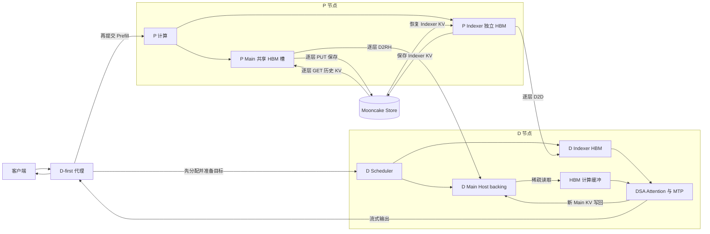
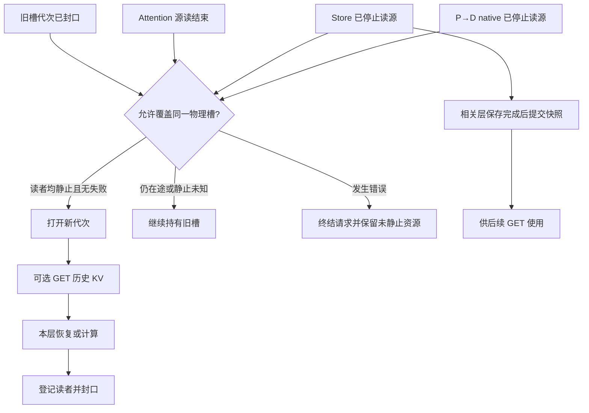
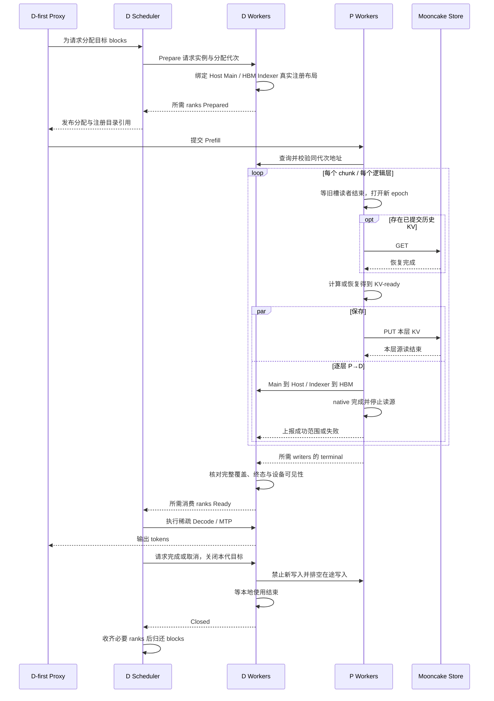
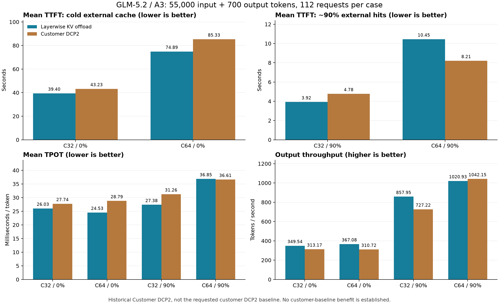

# GLM-5.2 Layerwise KV Offloading 特性报告

日期：2026-11-21
对象：A3 集群上的最新特性实现；测试数据截至 2026-11-21。
生产代码：`43e124eb5ba11cec16360748c111f8066549c816`。
模型：`GLM-5.2-w4a8c8`，模型类型 `glm_moe_dsa`；vLLM-Ascend 0.30.0 系列。

## 1. 当前结论

本特性串起了 P 侧 Main KV 跨层复用、Mooncake Store 前缀保存/恢复、逐层 P→D 传输，以及 D 侧 Host KV 稀疏读取。P 使用少量共享 HBM 槽位承载多个逻辑层的 Main KV；D 将完整 Main KV 放在 Host DRAM，保留 Indexer 和稀疏计算所需的设备缓冲，从而减少完整 Main KV 对两侧 HBM 的占用。

特性镜像和两档引擎参数已完成实机验证。在第 4 节列出的 TP2/MTP5 性能配置上，独立语义回归 **48/48 通过**，覆盖全部 16 个 D；同一镜像在独立容量配置下，完成 **1,047,256 tokens** 的冷前缀端到端请求，正确返回预期标记词，TTFT **488.6s**，随后四条短请求及资源回收检查通过。

以客户实际 **D TP2 / DP16 / DCP2** 配置重新完成四档对照，双方共 **896/896** 正式请求成功。55K/700、0% 外部命中下，本特性 C32/C64 平均 TTFT 分别降低 **8.8%/12.2%**；约 90% 外部命中下，C32 降低 **17.9%**，C64 则增加 **27.3%**（10.45s 对 8.21s）。高命中 C64 仍有明显首 token 瓶颈，不能概括为全面快于 DCP。

此前误将 D TP4/DP8/DCP4 参考配置当作客户基线；本版性能表、图和原始结果均已替换为正确 DCP2 复测，旧收益结论撤回。两套部署的软件栈、P 参数和 KV 路径仍有差异，结果不能视为 offloading 单一开关的净收益。性能档与近 1M 容量档是两套启动参数。

## 2. 特性设计

### 2.1 数据放在哪里

| 数据/状态 | P 侧 | D 侧 |
|---|---|---|
| Main KV | 少量跨层共享 HBM 槽；按需从 Store 恢复 | 完整 backing 放 Host DRAM；按稀疏选择读取 |
| Indexer KV | 独立 HBM 布局 | 各消费 rank 的 HBM 布局 |
| 前缀与历史 chunk | Mooncake Store 的公共完整块、请求私有快照 | 不依赖 D 保留同一请求的历史前缀缓存 |
| 稀疏计算缓冲 | 按模型路径使用 | HBM top-k/selection 等缓冲，承载计算所需的局部数据 |
| 复用与回收状态 | 槽位代次、读者登记、源读完成状态 | 注册目录、请求分配代次、接收覆盖和关闭状态 |

这里的 D Host offload 是按层保存完整 Main KV，并非让 D 的所有逻辑层共用一个 Main 存储槽。Indexer、模型权重、MTP 和 top-k 缓冲仍占 HBM，因此 Host DRAM 容量很大也不等于任意增大 D 并发都不受显存约束。



### 2.2 为什么 P 的槽位可以复用

每个共享槽使用 `SlotEpoch(slot, generation, layer)` 标识当前逻辑层和代次。下一层覆盖同一物理槽前，必须满足：旧代已经封口，不再新增读者；Attention、Store 保存和 P→D 传输均已停止读取旧代。

若有 L 个逻辑 Main 层、B 个共享槽和 I 个独立 Main 层，Main 的主要常驻分配可从按 L 层分配变为按 B+I 份分配；Indexer 仍按独立布局保留。实际可用 block 数还受 Indexer、权重、MTP 和 staging 等约束，不能简单宣称总显存或容量按 L/B 等比变化。

同一个“完成”不能同时代替所有条件。例如，Store 已提交快照不代表 P→D native 传输已读完；native 已读完也不代表 D 已完成整请求的覆盖校验。



Store 的版本提交控制“后续 GET 可以看见什么”；源读结束控制“当前物理槽何时能被覆盖”。将两者分开，可以避免为了整个快照提交而阻塞每一次层间槽位轮换。

### 2.3 一次请求的完整流程



图中的并行表示有条件地流水推进，不表示实测所有通信都已被计算完全掩盖。共享槽不足、GET 尚未完成、读者尚未静止时仍需等待。

### 2.4 Prefix cache、chunk 与 MTP

完整块使用可跨请求复用的公共身份；未完成的尾部范围保存在请求实例和版本隔离的私有快照中。只有满足提交条件的版本才可恢复，避免在多 chunk 或 MTP 边界读到尚未完成或已被替换的数据。

即使 P 命中了 Store，D 仍需要收到它本次请求所需的完整 Main/Indexer 范围。P 计算量变少不会自动免除 P→D 传输。空 GET、纯恢复以及没有常规计算 hook 的路径，也必须经过槽位复用屏障。

本轮特性性能配置显式关闭本地 vLLM prefix caching，使用 Mooncake Store 的外部命中；MTP 在此路径上已验证。不能将这一结果推广为所有本地 APC、MTP、模型布局组合都已完成验证。

### 2.5 支持范围

本设计以两端布局、D-first、逐层推送、读者登记和安全回收为完整交付路径，支持在已适配布局下使用不同的 P/D 并行配置。

本报告实测包含 P TP16→D TP2、P TP8→D TP2，以及 P/D MTP1/5、MTP1/3。路由以实际注册目录和组件布局规划：共享 Main backing 使用唯一写入归属，Indexer 按 D 消费 rank 完整送达。因此 P/D TP 和 DP 可以不同，不需要把远端地址猜成与本 rank 相同的布局。

当前结果限定 GLM-5.2 MLA/DSA、已验证的 Main/Indexer 布局、A3、PP=1。D Host offload 路径使用 CP=1；不宣称支持任意模型、多种混合 attention group、任意 TP 组合或任意硬件。

## 3. 代码实现与状态归属

以下路径相对特性软件包的 `vllm_ascend/` 根目录。下表中 `kv_transfer/` 代表 `distributed/kv_transfer/`；列出的是实际实现位置。

| 模块 | 核心实现 | 接口与状态归属 |
|---|---|---|
| P 物理布局 | `kv_transfer/kv_pool/ascend_store/layerwise_cache_layout.py`，KV cache 构建接线 | 逻辑层到物理槽的映射；共享 Main 与独立组件的真实分配 |
| P 覆盖屏障 | `…/ascend_store/prefill_reuse.py` | `SlotBarrier.begin_write/register/seal/complete`；worker 本地的 epoch、读者和错误 |
| P Store 恢复/保存 | `…/ascend_store/pool_worker.py`、`kv_transfer.py`、`session_tracker.py`、`backend/mooncake_layerwise.py` | 公共块、私有快照、逐层 GET/PUT、异步源读与版本提交；使用已有 worker/session 状态 |
| 共同布局与规划 | `kv_transfer/kv_p2p/layerwise_offload_plan.py` | `TargetId`、`TargetAllocation`、`RankCatalog`、`RegisteredLayout`、`plan_writes`；描述组件、范围、归属与注册代次 |
| 控制与编码 | `…/kv_p2p/layerwise_offload_control.py`、`layerwise_offload_wire.py` | `PrefillControl`、`DecodeControl` 与控制通道；目录查询、准备、完成证明、关闭 |
| P native 发送 | `…/kv_p2p/layerwise_offload_sender.py` | `LayerwiseSender` 登记源读、提交 native 写、等待完成、上报覆盖；持有在途发送状态 |
| D 注册和接收 | `kv_transfer/sparse_kv_offload/layerwise_receive.py` | `register_model_targets`、`DecodeTargets`；真实 Host/HBM 视图、注册范围、请求绑定、接收覆盖和可见性 |
| D Host 存储与运行时 | `…/sparse_kv_offload/mooncake_host_pool.py`、manager 及 SFA backend | 复用既有 Host pool、稀疏 onload 和新 KV 写回；不另建一套生产 Host allocator |
| D 调度与回收 | `core/layerwise_decode_scheduler.py` | Ready 前不放行 Decode；关闭后继续 retention，收齐 Closed 才归还 blocks |
| 入口接线 | MultiConnector、LayerwiseConnector、model runner 与代理 | 使空恢复、层间复用、chunk 结束和取消都进入同一生命周期 |

实现上保留三种不同状态边界：**P 源槽何时安全覆盖、Store 版本何时可恢复、D 目标何时可消费/回收**。状态身份同时携带请求实例与代次，重复或迟到消息不能解除新代资源的占用。

关闭特性保留既有普通 HBM 路径；本报告的正式性能对照是 DCP+Store，而不是“完全原始、无 connector”的纯 HBM 服务。下面的最新功能补测也没有重新覆盖所有关闭特性的历史回归项。

### 3.1 新增代码量与统计口径

以开发基线 `4234a1f1815252e8b52c75d6956d0bdf9ae80cc0` 为起点，固定统计快照为 `148ec8dc4e1e913b6d17c2d4faab760c83e46741`。统计采用 Git 物理行增量，包含空行和注释；“净增 = 新增行 − 删除行”，不是去除注释后的有效代码行。后续增加本统计说明和统计 JSON 不回填到此快照，保证数字可复核。

**在线功能实现净增 4,066 行**：推理包内 4,042 行，代理 24 行。另有 UT 净增 2,233 行。连同独立部署/测试工具、启动 Shell 模板和绘图工具，**代码与脚本合计净增 8,020 行**；不将报告、JSON 结果数据、SVG 或模型/镜像体积算成特性代码。

| 类别 | 变更文件数 | 新增行 | 删除行 | 净增行 |
|---|---:|---:|---:|---:|
| 推理包生产代码 `vllm_ascend/` | 27 | 4,173 | 131 | **4,042** |
| D-first 代理 | 1 | 61 | 37 | **24** |
| 在线功能实现小计 | **28** | **4,234** | **168** | **4,066** |
| 单元测试 | 12 | 2,235 | 2 | **2,233** |
| 独立部署、测试客户端、打包工具 | 6 | 594 | 0 | 594 |
| 按节点展开的启动 Shell 模板 | 40 | 1,068 | 0 | 1,068 |
| 性能图绘制工具 | 1 | 59 | 0 | 59 |
| 代码、测试与脚本总计 | **87** | **8,190** | **170** | **8,020** |

小计行不与明细行重复累加。启动模板中的重复参数行也计入脚本行数；这部分是两档四节点的配置展开，不是 40 个独立功能模块。另有 9 个运行配置 JSON，共 91 行，按配置数据单独统计。

推理包生产代码按职责拆分如下，分组不重叠：

| 模块 | 变更文件数 | 新增行 | 删除行 | 净增行 |
|---|---:|---:|---:|---:|
| P Store、共享槽、快照和指标 | 11 | 977 | 88 | **889** |
| P/D 布局规划、控制协议、传输和指标 | 8 | 2,077 | 36 | **2,041** |
| D 注册与接收 | 1 | 479 | 0 | **479** |
| P/D 调度器 | 3 | 521 | 0 | **521** |
| MultiConnector、worker、KV coordinator 与 transfer engine 接线 | 4 | 119 | 7 | **112** |
| 推理包合计 | **27** | **4,173** | **131** | **4,042** |

27 个生产文件中，**9 个是新文件，共 2,475 行**；另有 **18 个基线已有文件净增 1,567 行**。未将已有大文件的全部当前行数计为本次实现，也未把基线已有的 Host pool、SFA 算子和运行时重复计为新增开发量。

| 新生产文件 | 当前行数 |
|---|---:|
| `core/layerwise_decode_scheduler.py` | 314 |
| `core/layerwise_offload_scheduler.py` | 135 |
| `core/prefill_restore_scheduler.py` | 72 |
| `distributed/kv_transfer/kv_p2p/layerwise_offload_control.py` | 354 |
| `distributed/kv_transfer/kv_p2p/layerwise_offload_plan.py` | 356 |
| `distributed/kv_transfer/kv_p2p/layerwise_offload_sender.py` | 311 |
| `distributed/kv_transfer/kv_p2p/layerwise_offload_wire.py` | 262 |
| `distributed/kv_transfer/kv_pool/ascend_store/prefill_reuse.py` | 192 |
| `distributed/kv_transfer/sparse_kv_offload/layerwise_receive.py` | 479 |
| 新文件合计 | **2,475** |

上述文件路径相对 `vllm_ascend/`。UT 按模块为 P Store/共享槽 8 个文件、净增 813 行；P/D 传输与调度 3 个文件、净增 1,365 行；worker 接线 1 个文件、净增 55 行。这里统计测试代码行数，不能将其当作测试用例数量或全量测试通过率。

同一快照下，Git 全仓库显示新增 19,732 行、删除 170 行，净增 **19,562 行**。其中 **11,542 行属于报告、运行配置、结果 JSON、SVG 等非代码内容**；PNG 不参与文本行数统计。因此不能将仓库约 1.96 万行的总增量表述成“新增了约两万行特性代码”。

逐文件明细及分组汇总随附件提供为 `figures/code-size.json`。有源码仓的读者可复核：

```bash
git diff --numstat 4234a1f1815252e8b52c75d6956d0bdf9ae80cc0 \
  148ec8dc4e1e913b6d17c2d4faab760c83e46741 -- vllm_ascend/

git diff --numstat 4234a1f1815252e8b52c75d6956d0bdf9ae80cc0 \
  148ec8dc4e1e913b6d17c2d4faab760c83e46741 -- tests/ examples/
```

## 4. 部署指导：纯脚本

### 4.1 交付物与环境准备

复现需要三类交付物：**包含本特性的推理镜像、模型权重、运行脚本包**。普通官方镜像不包含本文特性，不能仅替换启动参数来复现。

| 交付物 | 内容与获得方式 |
|---|---|
| 特性镜像归档 | `glm52-layerwise-kv-image.tar`，由特性提供方另行交付，约 21GB；本报告附件不包含大体积镜像 |
| 模型权重 | 完整 `GLM-5.2-w4a8c8` checkpoint，由使用方准备；各节点可放在不同的本地目录 |
| 运行与测试工具 | 本报告附件中的 `runtime/`：两档参数模板、标准库配置生成器、Docker 启动脚本和 HTTP 测试客户端 |
| 主机基础环境 | 4 台 A3，每台 16 个 NPU 设备，已安装匹配驱动和 Docker；通信 IP、网卡与 RoCE 网络可用 |

镜像已经包含推理代码、CANN 9.2 用户态运行环境和所需原生库，不要求读者准备开发源码目录。主机驱动仍需与该镜像环境匹配。

每台节点导入收到的镜像，并设置便于使用的本地别名：

```bash
docker load -i glm52-layerwise-kv-image.tar
docker tag \
  sha256:3de4ba4a2801ea65b97a7d32b02bf837abb7a5744e0b82605efa293cec5ada44 \
  glm52-layerwise-kv:20261119

docker image inspect --format '{{.Id}}' glm52-layerwise-kv:20261119
```

上面的内容 ID 是本报告实际验证镜像的 ID；`glm52-layerwise-kv:20261119` 是本文约定的本地别名，不是公开镜像仓库地址。没有获得对应镜像 tar 时，可以阅读与审核报告，但无法完整部署本特性。

### 4.2 两档已验证配置

| 参数 | 性能/功能档 | 近 1M 容量档 |
|---|---|---|
| P TP / DP | 16 / 2 | 8 / 4 |
| D TP / DP | 2 / 16 | 2 / 16 |
| P / D MTP speculative tokens | 1 / 5 | 1 / 3 |
| P 图模式 | eager | eager |
| D 图模式 | target FULL_DECODE_ONLY，draft eager | target/draft eager |
| P / D max_model_len | 1048576 / 524288 | 1048576 / 1048576 |
| P / D max_num_batched_tokens | 16384 / 192 | 16384 / 32 |
| P / D max_num_seqs | 64 / 8 | 8 / 8 |
| P / D 显存利用率参数 | 0.90 / 0.88 | 0.75 / 0.88 |
| P shared buffers / prefetch | 5 / 3 | 2 / 1 |
| Store segment / 注册 rank | 40GiB | 20GiB |
| D Host backing / D 实例 | 100GiB | 100GiB |
| D top-k / LRU threads | 4096 / 16 | 4096 / 16 |
| 代理端口 | 8499 | 8497 |
| 独立 Master / metrics | 50166 / 52166 | 50164 / 52164 |

性能档 D 图捕获 sizes 为 `[1,2,4,6,12,18,24,30,36,42,48]`，compilation mode=3；P 侧 GET 采用整层模式，`layerwise_get_max_transfer_blocks=0`。这些是本次测量的固定值，不表示每个场景的全局最优参数。

节点分工和 API（地址由使用方填写）：

| 节点 | 地址配置项 | 性能档 API | 容量档 API |
|---|---|---|---|
| p0 | P0_IP | 8410 | 8410–8411 |
| p1 | P1_IP | 8410 | 8412–8413 |
| d0 | D0_IP | 8420–8427 | 8420–8427 |
| d1 | D1_IP | 8428–8435 | 8428–8435 |

### 4.3 生成本地配置

解压附件后进入 `runtime/`，只需要 Python 3.9+ 标准库和 Bash，无需额外编排工具。

```bash
cd runtime
cp cluster.example.json cluster.json
```

将 `cluster.json` 中四个节点的 `CHANGE_ME` 改成实际通信 IPv4 地址，`nic` 改为通信网卡名。配置示意如下，尖括号内容必须替换：

```json
{
  "image": "glm52-layerwise-kv:20261119",
  "image_id": "sha256:3de4ba4a2801ea65b97a7d32b02bf837abb7a5744e0b82605efa293cec5ada44",
  "nic": "<通信网卡名>",
  "nodes": {
    "p0": "<P0_IP>", "p1": "<P1_IP>",
    "d0": "<D0_IP>", "d1": "<D1_IP>"
  }
}
```

生成性能档：

```bash
python3 render.py --config cluster.json --profile performance --output launch-performance
```

生成的 `p0/`、`p1/`、`d0/`、`d1/` 各含完整环境、引擎、Master、代理、Store 配置与 `run-node.sh`。将每个目录复制到对应节点的独立工作目录。例如：

```bash
scp -r launch-performance/p0 root@<P0_SSH_HOST>:/opt/glm52-layerwise-performance
# p1、d0、d1 同理，各自只复制本节点目录。
```

通信 IP 与 SSH 登录地址可以不同。模型不要求放在共享盘，各节点通过 `MODEL_DIR` 指定已有权重目录，脚本将其挂载到容器内统一的 `/models/GLM-5.2-w4a8c8`。

### 4.4 创建容器与启动服务

先释放计划用于本服务的 NPU；脚本发现已有 NPU 进程会退出，不会替用户停止原有任务。以下命令在各节点对应工作目录执行：

```bash
cd /opt/glm52-layerwise-performance
MODEL_DIR=/absolute/path/to/GLM-5.2-w4a8c8 bash run-node.sh create
```

创建的是新容器 `glm52-layerwise-performance`，不依赖任何旧容器。它使用 host 网络、private IPC、1TB 的 shm 大小上限及显式驱动/模型挂载，并校验镜像和包内源码/原生库清单。shm 大小上限不代表启动时立即分配 1TB；实际 Host backing 和 Store 分配仍按第 4.2 节参数发生。

驱动挂载列表按本次验证的 A3 主机布局提供；若本机安装路径不同，应先适配脚本中的挂载。`huge=always` 只用于容器私有 `/dev/shm`，不修改宿主机 sysctl。

按以下顺序启动：

```bash
# 1. 仅 p0：启动私有 Mooncake Master。
bash run-node.sh master

# 在 p0 确认 Master 的 metrics 已响应；按实际地址替换。
curl -fsS http://<P0_IP>:52163/metrics > /dev/null

# 2. 四台节点：各自启动本节点引擎。
bash run-node.sh engines
```

等待所有引擎 `/health` 返回 200：性能档为两个 P API 和八个 D API，地址/端口见第 4.2 节。全部就绪后，在 p0 执行：

```bash
# 3. 仅 p0：启动 D-first 代理。
bash run-node.sh proxy
curl -fsS http://<P0_IP>:8499/healthcheck
# 预期：status=ok，prefill_instances=2，decode_instances=8
```

引擎、代理和 Store 参数直接由随包 shell 提供，不需要现场安装开发分支或额外挂载源码。不要重复执行 `engines` 启动第二组进程；启动失败应先查看日志。

### 4.5 容量档、日志与停止

近 1M 档独立生成：

```bash
python3 render.py --config cluster.json --profile capacity --output launch-capacity
```

将四个目录分发到各节点的新工作目录，按相同的 `create → master → engines → proxy` 顺序启动。容量档容器名为 `glm52-layerwise-capacity`，Master/metrics 为 50164/52164，代理为 8497，健康检查应显示 4P/16D。两档占用同一批 NPU、部分 API 端口相同，切换前必须停止上一档，不能同时运行。

每个节点工作目录下的 `logs/` 保存本节点引擎日志；p0 另有 `proxy.log` 和 `kvmaster.log`。不要求共享盘。功能测试如需汇总审计日志，可将四个节点的 `logs/` 分别收集到 `<AUDIT_ROOT>/{p0,p1,d0,d1}/logs/`。

停止压测并确认引擎无 running/waiting 请求后，在四节点分别执行：

```bash
bash run-node.sh stop
```

脚本只停止本档有匹配标签的容器，不停止其它容器、不自动删除日志。容器已存在时 `create` 会失败，避免覆盖旧实验；新一轮应使用新的工作目录并显式管理旧容器。

**验证状态：**两档镜像内引擎参数及完整数据路径已通过本报告实机验证。面向不同地址、模型目录整理的通用容器封装已做本地生成和 shell 校验，尚未在另一套主机上重跑；它不构成对任意驱动安装布局的额外验证。

## 5. 功能验证

### 5.1 最新性能配置的独立语义回归

使用第 4 节的 TP2/MTP5/FULL 性能档，与正式性能配置的引擎命令一致，仅换实验目录、代理和独立 Master 端口。

性能矩阵结束后独立运行一轮，使用新的 nonce，包含三组各 16 条请求：

| 场景 | 输入与断言 | 结果 |
|---|---|---|
| 短请求 | 约 537–539 tokens，检索首部标记 MAPLE | 16/16 |
| 冷前缀并发多 chunk | 约 33.66K tokens，超过 16384 的单步预算，检索 MAPLE | 16/16 |
| 前缀复用后改问尾部 | 复用对应长前缀，问题改为检索 QUARTZ | 16/16 |
| 合计 | 答案匹配、正常 stop | **48/48** |

本轮覆盖全部 16 个 D 引擎，所有请求均有 TP2 Ready/Closed；长前缀复用检查通过。最后全部 18 个引擎健康，running、waiting、KV 使用量均为零。

随包 `runtime/tools/smoke.py` 可从能访问代理的 Python 环境发起独立语义检查。需要完整日志审计时，在用例完成后提供收集到的四节点日志；在线使用则需将 `--logs` 指向能看到四节点日志的目录：

```bash
python3 runtime/tools/smoke.py \
  --proxy http://<P0_IP>:8499 --logs . --skip-log-audit \
  --tp 2 --expected-decode-engines 16 --layerwise > semantic-results.jsonl

# 收集四节点日志后，单独进行离线生命周期审计。
python3 runtime/tools/smoke.py \
  --audit-results semantic-results.jsonl --logs <AUDIT_ROOT> \
  --tp 2 --expected-decode-engines 16 --layerwise
```

审计模式可以针对已完成请求结果离线执行，避免要求读者拥有与原测试相同的共享盘。日志中需保留请求 ID 及 Ready/Closed 事件。

这是一组带明确答案的基本语义和生命周期回归，不是通用精度基准。性能测试中的随机文本响应成功率另行统计，不计入语义通过数。

### 5.2 同一镜像的近 1M 验证

采用独立容量档。实际请求带新的文档 nonce，在很长的填充文本首部放置 MAPLE，尾部放置 QUARTZ，要求只回答首部标记；先调用服务 `/tokenize` 校验真实长度，再经 D-first 代理发流式请求。

| 项目 | 实测 |
|---|---|
| 实际输入 | **1,047,256 tokens**；tokenize 与响应 usage 一致 |
| 外部缓存 | **0/8180** 完整块，冷前缀 |
| 输出 | **MAPLE**，3 completion tokens，finish_reason=stop |
| TTFT | **488.5746s** |
| E2E | **488.5870s** |
| 接收与回收 | TP2 Ready/Closed 完整 |
| 后续短请求 | **4/4** 答案正确，各有 Ready/Closed |
| D 生命周期计数增量 | prepare、ready、close_started、close 各 5 |
| 最终状态 | **20/20 引擎健康**，running/waiting/KV 均归零 |

启动容量档后，使用随包近 1M 探针：

```bash
python3 runtime/tools/long_probe.py \
  --proxy http://<P0_IP>:8497 --tokenize http://<P0_IP>:8410 \
  --output near-1m-result.jsonl
```

工具先校验实际 tokenize 数，再提交流式请求并保存首 token、答案、usage 和结束状态。输出文件必须是新文件，避免覆盖已有结果。

本项证明最新镜像在已验证容量配置下能完成接近 1,048,576 上限的实际请求，不只是配置项或启动日志显示 1M。它没有测试满额 1,048,576 输入、近 1M 并发或长输出，也没有覆盖复杂长文推理质量。488.6s 是一次容量验证观测值，不能当成稳态 1M 性能 SLA。

## 6. 性能测试方法与观测

### 6.1 负载与客户端

测试使用兼容 OpenAI Chat Completions 的 HTTP 流式压测客户端，不要求压测端有 NPU 或推理镜像。客户端构造多前缀输入，通过 SSE 读取响应，并检查错误、`[DONE]`、usage 和实际输出数，防止把不完整请求当作成功。

本文给出负载构造、缓存验证和计时协议。附件另提供只依赖 Python 标准库的 `runtime/tools/http_bench.py` 参考客户端，普通 CPU 主机即可运行。它是按相同指标口径整理的复测工具，不是产生下述正式数据的原始执行程序，尚未用它重新跑完整性能矩阵。

| 条件 | 取值 |
|---|---|
| 实际输入 / 输出 | 55,000 / 700 tokens |
| 并发 | C32、C64，闭环 max-concurrency，request-rate=inf |
| 正式请求数 | **每档 112 条**，每套配置四档共 448 条 |
| 前缀组数 | **112 个独立前缀组，每组 1 条正式请求** |
| 缓存档 | 0%、目标约 90% 外部 token 命中 |
| seed | 20261106 |
| 输出控制 | ignore_eos=true、固定 700 tokens、关闭 thinking |
| profiling | **关闭**；本轮无 stack profiler 开销 |
| 预热隔离 | 前缀预热与正式请求分开计数；无额外传输预热请求 |

双方四档正式输入和前缀 SHA256 逐条核对相同，正式请求均为 112/112 成功。随机输入用于测性能，不评价回答语义或精度。

“90%”表示每条请求约九成输入 tokens 可从外部缓存恢复，不是九成请求完全命中。块对齐后，特性实测 **90.065%**（约 49,536 tokens/请求），DCP 实测 **89.367%**（约 49,152 tokens/请求）；两者都必须在 P 侧指标中证实，P 本地 HBM prefix 命中实测为 0。

### 6.2 如何避免少数组前缀让 DCP 只命中 HBM

DCP 每个 P 实测 HBM KV 容量 **2,682,880 tokens**。按 49,152 tokens 的可复用前缀估算，至少需要 **55 组**才超过单 P HBM。本轮使用 **112 组**，每 P 完整工作集为：

```text
112 × 49,152 = 5,505,024 tokens
5,505,024 / 2,682,880 ≈ 2.052
```

DCP 热档按两波预热同一批 112 组，使两个 P 各遍历完整工作集，共 **224 条成功预热请求/热档**；随后对两个 P 显式 reset 本地 prefix cache，保留 external Store，再进入正式阶段。正式指标证实 P 本地 HBM prefix 命中为 0，外部命中约 89.37%。

特性热档每组先预热一次，共 112 条；本地 APC 关闭，正式外部命中约 90.07%。工作集超过 HBM 是负载设计；正式 counter 差值才是最终缓存来源证据，不能单凭组数推断命中来源。

客户 D 保留原配置默认本地 prefix cache，热 C32/C64 的 D 本地 token 命中分别为 2.41%/7.09%；特性 D 本地命中为 0。P 外部命中率不使用 D 的接收/查询计数替代。

特性采用自然 P 路由，DCP 正式请求按组固定均分；这项路由差异也保留在结果解释中，没有把负载脚本里预期路由字段当作实际调度事实。

### 6.3 与压测工具无关的复测步骤

1. 固定模型 tokenizer 与随机 seed，构造 **112 个不同前缀组**。每组准备一条预热文本和一条正式文本；正式文本的真实输入为 55,000 tokens，预热与正式文本共享约 49.6K tokens。用服务 `/tokenize` 校准长度，记录前缀/完整输入 SHA256。
2. 每轮使用独立 cache salt，防止与其它实验串缓存。冷档不预热；热档先完成所需前缀预热。DCP 按第 6.2 节遍历两个 P 的完整工作集，再 reset 本地 prefix，保留外部 Store。P 路由和本地 cache reset 由服务部署侧控制，不由普通 HTTP 并发数自动保证。
3. 保存全部 P/D 正式前指标，确认服务空闲；此后取正式采样，不能把预热混入正式统计。
4. 发起 112 条请求，最大并发设为 32 或 64，输出固定 700 tokens；关闭 profiler，检查每条响应完整且 token 数符合预期。
5. 保存正式后指标，计算 P 的外部 token 命中率、本地 HBM 命中率、排队及 prefill counter 增量；未达到目标命中的一轮不能按“90% 外部命中”归档。
6. 检查请求全部结束、Ready/Closed 完整、running/waiting/KV 回到空闲状态，再进入下一档。C32/C64 的热档分别准备独立工作集。

参考客户端读取已准备的 JSONL，每行格式为：

```json
{"group":"prefix-000","prompt":"已按服务 tokenizer 校准的正文","cache_salt":"本轮唯一标识-prefix-000"}
```

上述正文是格式示意，不是 55K 测试数据。应先按步骤 1 生成足量文本；不要把示意文本直接拿来与本报告数值比较。

```bash
# 在任意能访问代理的 CPU 主机执行；同样的输入分别用于两套服务。
python3 runtime/tools/http_bench.py \
  --url http://<PROXY_IP>:<PORT> --requests formal-requests.jsonl \
  --concurrency 32 --input-tokens 55000 --max-tokens 700 --output c32.jsonl

python3 runtime/tools/http_bench.py \
  --url http://<PROXY_IP>:<PORT> --requests formal-requests.jsonl \
  --concurrency 64 --input-tokens 55000 --max-tokens 700 --output c64.jsonl

# 预热请求需使用每组的“前缀文本”，不应包含正式请求的完整后缀。
python3 runtime/tools/http_bench.py \
  --url http://<PROXY_IP>:<PORT> --requests prefix-warmup.jsonl \
  --concurrency 32 --input-tokens 0 --max-tokens 1 --output warmup.jsonl
```

以上客户端负责并发、SSE 完整性、token 计数和 TTFT/TPOT/吞吐，不自动构造前缀、选择 P、清理 HBM 或证明缓存命中来源；这些必须按步骤 1–6 配套完成。每轮使用新的输出文件，保留逐请求结果与采样数据。

### 6.4 观测与统计口径

| 观测层 | 指标或证据 | 用途与解释 |
|---|---|---|
| 客户端 | 逐请求 ID、首内容 token、E2E、usage、SSE 完整结束 | TTFT 分布、有效输出数、TPOT |
| P API | `num_requests_running/waiting`、waiting reason、queue/prefill 时间 | 判断排队和 P 请求处理时间；prefill 指标不是纯 kernel 时间 |
| P 缓存 | `prefix_cache_hits_total`、`external_prefix_cache_hits_total` | 正式前后 delta / 实际输入 tokens；仅统计 P，不能把 D 接收 KV 算作 P 前缀命中 |
| P Store/共享槽 | `ascend_store_prefill_operations_total`、`ascend_store_prefill_operation_seconds_total`，phase 标签 | 观察槽位 acquire、Store 调用等 worker 累计耗时 |
| P→D | native 写提交/完成指标，接收范围及 writer terminal | 区分源读完成、协议证明和目标完整性 |
| D | prepare/ready/close 生命周期指标、Ready/Closed 日志、KV 使用量 | 验证准入、消费、排空和回收 |
| Master | Store metrics、预热与正式前后快照 | 辅助确认外部存储运行状态，不替代逐请求 token 命中计数 |

统计口径：

- **TTFT**：从客户端发出到首个内容输出，包含代理、排队、P 处理、P→D 协作和 D 首 token 等待。
- **TPOT**：逐请求 `(E2E − TTFT) / (实际输出 tokens − 1)`，再求请求均值。MTP 一次可输出多个 token，不能把服务端单次输出事件间隔直接当 TPOT。
- **输出吞吐**：正式阶段实际输出 tokens / 工具记录的测量时长，不含前缀预热；单位 tokens/s。
- **P queue/prefill**：所有 P 的正式 counter delta 汇总后除以正式请求数。不能把分布的 P50 与不同口径均值直接相减，拼成一个 TTFT 分解。
- **外部 token 命中率**：P 侧 `external_prefix_cache_hits_total` 正式增量 / 正式实际输入总 tokens。本轮本地 prefix counter 增量为 0。

最新特性四档在正式阶段每 2 秒通过 HTTP `/metrics` 采样 running/waiting 与 capacity 原因，不 attach worker、不启用 profiler；另外保存完整的正式前后 metrics。只统计 ready-timestamp 之后的正式样本，避免将前缀预热混入排队诊断。

后续 kernel 诊断可以另开 profiler，用同请求 ID 对齐 host/device 时间线；本报告没有最新 TP2/MTP5 档的完整 kernel profiling 证据，因此不宣称当前 GET、P→D 或 HCCL 的全部耗时已经被计算掩盖。

## 7. 与客户 DCP2 的性能对比

### 7.1 实际配置与剩余差异

客户基线的 DCP2 指 D 侧 `--decode-context-parallel-size 2`。启动命令及镜像 ID 已逐项核对；审计见附件 `figures/baseline-audit.json` 和 `results/{feature,dcp}/actual-config-audit.json`。

| 参数 | 本特性 | 客户 DCP2 |
|---|---|---|
| 硬件与模型 | 4×16 卡 A3、GLM-5.2-w4a8c8 | 相同 |
| 软件 | 本报告固定 0.30 系列特性镜像 | `quay.io/ascend/vllm-ascend:v0.23.0-a3` |
| P TP / DP | 16 / 2 | 16 / 2 |
| P DCP / PCP 启动参数 | 1 / 1，另启用 enable_dsa_cp | 16 / 1 |
| P MTP / 图 | 1 / eager | 1 / eager |
| P batch tokens / max seqs | 16384 / 64 | 8192 / 64 |
| P max_model_len / OMP threads | 1048576 / 20 | 593920 / 1 |
| D TP / DP / DCP | 2 / 16 / 1 | 2 / 16 / 2 |
| D MTP / 图 | 5；draft eager、target FULL | 相同模式 |
| D batch tokens / max seqs | 192 / 8 | 192 / 8 |
| D max_model_len / GPU utilization | 524288 / 0.88 | 524288 / 0.88 |
| D HCCL buffer | 400 | 400 |
| D Main KV | Host backing + 稀疏 onload | DCP2 的 HBM KV |
| D 调度与计算 | Host offload 专用生命周期；MLAPO/recompute 关闭 | 客户原始路径 |
| 图捕获参数 | 显式 sizes 最大 48 | 原配置自动捕获 |
| P 正式路由 | 自然路由 | 按组固定均分 |

为了保存超过单 P HBM 的外部前缀工作集，两边测试的 Store 均设置为每注册 rank 40GiB、lease 60s，并启用同节点优先分配及独立 Master；这替换了客户原 Store 的 8GB/11s 设置。客户模型、并行度、长度和 batch 参数保留。D 本地 prefix cache 沿用客户配置默认开启；特性关闭本地 APC。

这是两套部署的整体性能对照，D 主要容量、并行度和 MTP 参数已拉齐，但不是单变量消融。P enable_dsa_cp 与 CLI DCP 数值不能直接等同；没有证据将图捕获参数差异解释为已发生不同 padding。不能把全部差值归因于 offloading。

### 7.2 四档正式结果

每行 112 条正式请求，双方各 448/448 成功，profiler 关闭。热档 P 外部 token 命中分别为 90.065% 和 89.367%，双方 P 本地 prefix 命中均为 0。

| 外部命中档 | 并发 | 配置 | TTFT 均值 s | TTFT P50 s | TTFT P99 s | TPOT 均值 ms | 输出吞吐 tok/s |
|---|---:|---|---:|---:|---:|---:|---:|
| 0% | 32 | 本特性 | 39.40 | 37.55 | 69.91 | 26.03 | 349.54 |
| 0% | 32 | 客户 DCP2 | 43.23 | 40.87 | 77.72 | 27.74 | 313.17 |
| 0% | 64 | 本特性 | 74.89 | 91.49 | 114.65 | 24.53 | 367.08 |
| 0% | 64 | 客户 DCP2 | 85.33 | 105.90 | 128.14 | 28.79 | 310.72 |
| 90% | 32 | 本特性 | 3.92 | 1.82 | 14.83 | 27.38 | 857.95 |
| 90% | 32 | 客户 DCP2 | 4.78 | 2.48 | 15.60 | 31.26 | 727.22 |
| 90% | 64 | 本特性 | 10.45 | 8.52 | 28.23 | 36.85 | 1020.93 |
| 90% | 64 | 客户 DCP2 | 8.21 | 5.64 | 20.75 | 36.61 | 1042.15 |



图中 TTFT 为均值，P50/P99 见表；精确数值及绘图脚本见 `figures/`。

| 外部命中档 / 并发 | TTFT 均值变化 | TPOT 均值变化 | 输出吞吐变化 |
|---|---:|---:|---:|
| 0% / C32 | -8.8% | -6.1% | +11.6% |
| 0% / C64 | -12.2% | -14.8% | +18.1% |
| 90% / C32 | -17.9% | -12.4% | +18.0% |
| 90% / C64 | +27.3% | +0.7% | -2.0% |

变化均以客户 DCP2 为分母。冷档两种并发及热 C32，本特性这三个指标均有改善；热 C64 的平均 TTFT 增加 27.3%，P50 为 8.52s 对 5.64s，P99 为 28.23s 对 20.75s。该档 TPOT 近似持平，吞吐低 2.0%，不能表述为本特性全面领先。

### 7.3 P 排队与处理时间

| 外部命中档 / 并发 | 本特性 P queue / prefill s | 客户 DCP2 P queue / prefill s |
|---|---|---|
| 0% / C32 | 31.37 / 4.68 | 33.76 / 5.12 |
| 0% / C64 | 68.25 / 4.50 | 75.69 / 5.16 |
| 90% / C32 | 1.09 / 1.44 | 1.01 / 1.26 |
| 90% / C64 | 5.48 / 2.35 | 2.29 / 1.50 |

冷档从 C32 到 C64，两边 P 单次 prefill 耗时接近不变，主要增长出现在排队。热 C64 的本特性 P queue 5.48s 对 2.29s、prefill 2.35s 对 1.50s，说明高并发 P 调度及处理仍是后续诊断重点。现有 metrics 无法将差额精确归因于 GET、HCCL、算子或 CPU；不同时间窗的均值也不能直接当成逐请求 TTFT 的严格分解。

本特性正式阶段每 2s 采样 D metrics：

| 外部命中档 / 并发 | 样本数 | D capacity 等待总峰值 | 单 D running 峰值 | HTTP 错误 |
|---|---:|---:|---:|---:|
| 0% / C32 | 114 | 0 | 2 | 0 |
| 0% / C64 | 109 | 0 | 2 | 0 |
| 90% / C32 | 47 | 0 | 2 | 0 |
| 90% / C64 | 41 | 0 | 5 | 0 |

有限采样不能排除采样间隔内的短暂容量等待；该观测不是逐事件跟踪。

### 7.4 适用范围

每档仅一次、112 条闭环正式请求，C64 不足两轮完整并发窗口，尾部排空影响吞吐与分位数。没有重复试验置信区间或长期稳态 SLA。结果只覆盖当前 55K/700、C32/C64、0%/约90% 外部命中；没有混入其它版本的 50%、96K/128K 或旧 profiling。近 1M 是独立容量档的功能验证，不代表本性能档的长度上限或吞吐。

## 8. 交付内容与结论边界

报告附件按读者可独立获取的内容组织：

| 附件 | 用途 |
|---|---|
| `report.md` | 本报告，包含完整设计、部署参数、测试协议和结果，不需要其它设计文档 |
| `figures/` | 性能图 PNG/SVG、精确数值 JSON 和绘图脚本 |
| `runtime/` | 两档参数模板、地址配置生成器、Docker 启动脚本和 HTTP/语义/近 1M 工具 |
| `results/feature/`、`results/dcp/` | 四档原始统计结果与输入摘要，用于核对表格 |
| `results/functional/`、`results/capacity/` | 语义回归、实际近 1M 响应、接收/关闭和资源收尾证据 |
| `MANIFEST.sha256` | 附件完整性校验 |

特性镜像 tar 与模型权重体积较大，**不在本报告附件中**，需由提供方另行交付。通用运行脚本无法把普通官方镜像变成本特性镜像；报告中的本地别名也不代表公开可下载地址。

当前证据支持描述本模型、硬件与固定配置下的实际功能和四档性能。有限标记检索不等于完整精度评测；此前实验中曾记录个别短请求异常输出，本轮全部通过不能替代其根因分析。native 失败后若无法证明读写静止，安全策略会继续持有相关资源，必要时需要 worker 重启，不能宣称所有异常均自动恢复。

性能比较是每档一次的有限闭环测试，不是消除软件栈与所有参数差异后的单变量实验。近 1M 是独立容量档的单请求验证；本报告不以它承诺性能档可直接运行 1M，也不承诺生产 SLA。
